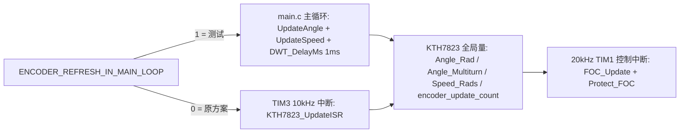

## 用户需求
将当前项目中 "编码器（KTH7823）刷新由 TIM3 中断（10kHz）执行" 的机制，**临时**改回旧版方式：在主循环中轮询刷新（约 1kHz），以便进行对比测试。

## 核心要求
- 测试模式默认启用：主循环每次循环调用 `KTH7823_UpdateAngle()` + `KTH7823_UpdateSpeed()`，并以 `DWT_DelayMs(1)` 维持约 1kHz 刷新节奏（与旧版一致，保证对比条件相同）。
- 测试期间 TIM3 不再启动、不再调用 `KTH7823_UpdateISR()`，但相关代码保留，不删除。
- 改动必须**可低成本回退/可删除**：单个开关切回即完全恢复现有 TIM3 中断方案；测试不通过时可整体删除测试代码，行为与当前版本一致。
- 不改动 FOC 算法、保护阈值/判据、CAN 与串口协议、外设寄存器配置，不新增文件。

## 预期效果
- 上电后编码器由主循环按约 1kHz 刷新，`encoder_update_count`、`kth7823_raw_fault_cnt`、`KTH7823_Angle_Multiturn`、`KTH7823_Speed_Rads` 仍正常更新。
- 20kHz 控制中断读取到的角度最旧约 1ms，控制动态性能会下降（这正是本次测试要观察的对比点）。
- 开关置回后，TIM3 中断刷新链路（10kHz）恢复，与改动前完全一致。


## 技术栈
沿用现有嵌入式工程：STM32G4 + HAL 库 + Keil MDK-ARM（`MDK-ARM/` 工程），C 语言，无新增依赖。

## 实现方案
采用**单一编译期开关 + 条件编译**的方式，把"编码器刷新位置"变成可翻转的配置项，而不是直接删改代码。这样能同时满足"临时测试"和"测试不通过可删除回退"两个诉求，且回退时零逻辑改动。

关键决策与理由：
1. **开关放在 `Core/Inc/kth7823.h`**：`motor_control.c` 已 `#include "kth7823.h"`，`main.c` 通过 `motor_control.h`（其中 `#include <KTH7823.h>`）间接包含，因此三个改动点共享同一宏，不需要新增头文件，也不会出现两处取值漂移。
2. **TIM3 启动与回调一并条件编译**：只屏蔽 `HAL_TIM_Base_Start_IT(&htim3)` 即可让回调永不触发，但把回调分支一起包进 `#if` 可以让"测试模式"语义显式、避免未来误接；恢复时只需把宏置回原值。
3. **`KTH7823_UpdateISR()` 保持不动**：它只是 `UpdateAngle + UpdateSpeed` 的组合入口，保留后回退时无须重新编辑 `KTH7823.c`。
4. **保护逻辑不改**：`Protect_EncoderStallCheck()` 的判据已改为"`kth7823_raw_fault_cnt` 连续无效读数 ≥ `KTH7823_RAW_FAULT_LIMIT`"，与刷新位置无关；`encoder_update_count` 仅用于"等待刷新开始 + 100ms 观察窗"的武装条件，主循环刷新同样满足。
5. **单写者保证**：已确认全工程只有 `motor_control.c:110` 调用 `KTH7823_UpdateISR()`，`KTH7823_UpdateAngle/Speed` 无其它调用点。测试模式下主循环成为唯一写者，不存在两处并发刷新同一组滤波/解包裹静态变量的问题（这点很关键，否则会破坏 `angle_unwrapped`、`filtered_cos/sin`、`last_speed_tick` 的状态一致性）。

性能与副作用（测试可预期，需在报告中说明）：
- 主循环新增 1ms 延时后，CAN/串口命令处理节奏约 1kHz；CAN 接收队列深度 16（`FDCAN_RX_QUEUE_SIZE`）可缓冲突发帧，不会丢命令。
- 编码器 SPI 阻塞读在主循环执行（单帧 16bit @ SPI1 4 分频），中断内不再有 SPI 访问，20kHz 控制节拍不受阻塞影响。
- 角度/速度的 32 位对齐存取在 Cortex-M4 上是原子的，主循环写、中断读不会撕裂（与旧版一致）。
- `SPEED_FILTER_ALPHA=0.15`、`ANGLE_FILTER_ALPHA=0.10` 原按 10kHz 调参，改为 1kHz 后等效时间常数放大约 10 倍、测速噪声变大，属于本次对比测试需要观察的差异，不修改系数（否则失去对比意义）。

## 实施细节（执行要点）
- 开关宏建议命名 `ENCODER_REFRESH_IN_MAIN_LOOP`，取值 1 = 主循环（测试），0 = TIM3 中断（原方案），默认按需求置 1，并在注释中写清"删除方法"（删宏 + 三处 `#if` 块即可回到 TIM3 方案）。
- `Core/Src/motor_control.c` 第 72-73 行 `HAL_TIM_Base_Start_IT(&htim3);` 与第 108-111 行 `else if (htim->Instance == TIM3) { KTH7823_UpdateISR(); }` 两处都要包进条件编译，保持"启动 + 执行"成对开关；不改变 TIM1 相关初始化顺序。
- `Core/Src/main.c` 主循环末尾（`HAL_IWDG_Refresh(&hiwdg);` 附近，第 255-260 行区间）加入条件编译块：先刷新编码器，再 `DWT_DelayMs(1)`；`main.c` 已包含 `dwt_delay.h`，无需新增 include。喂狗位置保持在延时之后、每轮必达，IWDG 超时 1s 仍安全。
- 不要动 `Core/Src/KTH7823.c`（含 `KTH7823_UpdateISR` 与滤波逻辑）、`Core/Src/Protect.c`、`Core/Src/FOC.C`、CAN/串口代码。
- 保留可直接观察的验证量：串口 `status`/`can` 诊断、`encoder_update_count`、`kth7823_raw_fault_cnt`、`kth7823_unwrap_glitch_cnt`、`KTH7823_Speed_Rads`；用于确认刷新确实在跑、且无异常读数/野值激增。

## 架构设计
改动仅在"调度层"（谁在什么上下文调用编码器刷新），不触及数据流与算法层：



## 目录结构
```
doog_drive/
└── Core/
    ├── Inc/
    │   └── kth7823.h        # [MODIFY] 新增测试开关宏 ENCODER_REFRESH_IN_MAIN_LOOP（默认 1=主循环），
    │                        #          配套注释说明两种取值含义、影响范围与 [TEST] 删除方法
    └── Src/
        ├── motor_control.c  # [MODIFY] MotorControl_Init 中 HAL_TIM_Base_Start_IT(&htim3) 与
        │                    #          HAL_TIM_PeriodElapsedCallback 的 TIM3 分支加条件编译，
        │                    #          仅当开关=0 时启动/执行 KTH7823_UpdateISR()
        └── main.c           # [MODIFY] while(1) 末尾（HAL_IWDG_Refresh 之前）加条件编译块：
                             #          开关=1 时 KTH7823_UpdateAngle(); KTH7823_UpdateSpeed(); DWT_DelayMs(1);
                             #          并注明测试目的、恢复方式与副作用
```

