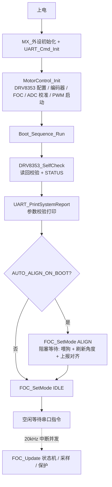

## Product Overview
为关节电机驱动器增加"上电自动执行"能力：设备通电后无需人工干预，自动完成初始化与自检，并以确定的状态（空闲）等待上位机指令，降低整机上电调试与批量部署的操作成本。

## Core Features
- 上电按固定顺序自动执行：外设初始化 → 驱动自检配置 → 参数校验打印 → 自动对齐 → 进入空闲模式
- 驱动自检配置：读回驱动芯片配置寄存器并校验状态寄存器，输出自检结果
- 参数校验打印：逐项检查控制参数与运行条件（PID、软限位、位置误差阈值、转矩常数、母线电压、温度、关键编译常量），打印数值与"通过/告警"标识
- 自动对齐：上电自动完成一次两步转子对齐并输出方向/零点偏移结果；可用编译开关启用或关闭，默认开启，便于整机装配时关闭
- 立即进入空闲模式：停止输出，等待串口指令；无指令时保持静止
- 告警不阻断：自检或对齐发现异常时完整打印提示，仍进入空闲模式等待指令，不停机
- 串口交互：进入空闲后可通过既有串口命令切换模式与给定参数；CAN 通道保持关闭

## 视觉与呈现
无图形界面。启动过程通过串口输出文本日志：自检结果、参数校验表、对齐结果与就绪提示，便于上位机与调试终端观察。


## Tech Stack
- 平台：STM32G474（Cortex-M4），HAL 库驱动，Keil MDK 工程（MDK-ARM/Drive.uvprojx）
- 语言：C（现有 FOC 电机控制固件，Core/Src + Core/Inc）
- 通讯：USART3（115200，环形缓冲 + DMA 非阻塞发送）；FDCAN 保持注释不启用
- 关键既有模块：motor_control.c（初始化与 20kHz 控制中断）、FOC.C（状态机/对齐）、DRV8353.C（驱动配置）、uart_cmd.c（串口命令）、Protect.c（保护）、sense.c（采样）、iwdg.c（看门狗）

## Implementation Approach
在不新增文件、不改动 MDK 工程配置的前提下，复用现有模块与既有输出通道，新增一条"启动序列"编排逻辑，按逻辑依赖顺序执行并在结束时进入 IDLE：

1. **驱动自检配置**：在 DRV8353.C 新增 `DRV8353_SelfCheck()`，对已由 `DRV8353_Init()` 配置好的寄存器做读回校验（DRIVER_CTRL 的 PWM 模式/OCP_ACT、GATE_DRIVE_HS/LS、OCP_CTRL、CSA_CTRL，按可写位掩码比对），并读取 STATUS1/STATUS2，返回按位编码的诊断结果（0 = 全通过）。保持该模块与串口解耦，只返回结果。
2. **参数校验打印**：在 uart_cmd.c 新增 `UART_PrintSystemReport()`，复用既有 sprintf + `UART_SendString`（非阻塞）模式，集中打印各类参数与阈值检查结论（PASS/WARN）。打印时机在自检之后、对齐之前（对齐尚未产生 encoder_offset，报告中不包含该项）。
3. **自动对齐**：在 main.c 新增 `Boot_Sequence_Run()`，用编译宏 `AUTO_ALIGN_ON_BOOT`（默认 1）控制。对齐通过 `FOC_SetMode(FOC_STATE_ALIGN)` 触发，对齐状态机在 20kHz 中断内运行。由于该阶段主循环尚未启动，等待循环内必须持续调用 `KTH7823_UpdateAngle()/KTH7823_UpdateSpeed()`（刷新角度并递增 encoder_update_count）、`UART_ReportAlignResult()`、`UART_Tx_Poll()`、`HAL_IWDG_Refresh()`，并以 `DWT_DelayMs(1)` 节拍。以 `foc.mode != FOC_STATE_ALIGN`（对齐结束会切回 OPENLOOP）或超时（建议 3000ms）作为退出条件。
4. **进入 IDLE**：清零 `manual_voltage/manual_speed/foc.target_speed/foc.target_torque` 并调用 `FOC_SetMode(FOC_STATE_IDLE)`，打印就绪提示，随后主循环等待串口指令。

关键决策与取舍：
- **不改 MDK 工程、不新增文件**：新增 .c/.h 需手动登记到 uvprojx，风险高；把编排放 main.c、自检放 DRV8353.C、报告放 uart_cmd.c，符合现有"按模块分文件"的约定且零工程改动。
- **阻塞式等待对齐**：上电阶段无并发任务，阻塞最简单可靠；代价是约 1.6s 启动停留，由等待循环持续喂狗（IWDG 约 1s 超时）规避复位。
- **故障不阻断**：用户明确要求自检/对齐异常仍进 IDLE，采用"打印告警 + 继续"策略，最大化远程可诊断性。
- **默认安全态**：将 `FOC_Init()` 默认状态由 OPENLOOP 改为 IDLE，使任何路径下上电初始都是无输出安全态，与"立即进入空闲"一致。

性能与可靠性：
- 启动序列为一次性、有界（自检毫秒级 + 对齐约 1.6s + 超时上限 3s），不影响后续 20kHz 控制实时性（启动完成后才进入主循环）。
- 等待对齐期间 SPI 角度读取以约 1kHz 节拍进行，远快于编码器失速阈值（10ms @20kHz），不会误触发 `Protect_EncoderStallCheck`。
- CAN 未启用时 `comm_armed=0`，`Protect_CommTimeoutCheck` 不生效，IDLE 下不会误报通讯失联。

## Implementation Notes
- **喂狗**：对齐等待循环必须每个节拍调用 `HAL_IWDG_Refresh(&hiwdg)`，否则 IWDG 复位。
- **角度刷新**：等待循环必须持续调用 `KTH7823_UpdateAngle()`；对齐在中断内消费 `KTH7823_Angle_Rad`，主循环不刷新会导致对齐结果错误。
- **对齐结果复用**：不必自行解析，等待循环内调用既有 `UART_ReportAlignResult()` 即可完成格式化输出与 delta 过小/过大 WARN（避免重复实现）。
- **读回掩码**：DRV8353 各配置寄存器含只读/状态位，比对时需按可写位掩码（如 DRIVER_CTRL 比较 PWM_MODE(0x0060) 与 OCP_ACT(0x0400)），不要整寄存器相等比较。
- **采样就绪**：参数校验读取 `bus_voltage/ntc_temperature` 前，确保已过若干控制中断周期（自检含 1ms 级延时，通常已就绪），必要时在报告前加短暂延时。
- **副作用控制**：不改动主循环既有任务顺序与保护逻辑；启动序列通过既有 `FOC_SetMode` 入口切换状态，避免旁路 PID 复位与角度对齐逻辑。
- **日志安全**：仅打印配置数值与状态位，不打印敏感信息；输出走既有非阻塞发送。

## Architecture Design
现有架构为"初始化 → 20kHz 控制中断（FOC/采样/保护） + 主循环（命令/上报/编码器）"。本方案在初始化与主循环之间插入一次性的启动序列，作为二者之间的前置编排层，不改动中断与主循环的既有结构。



## Directory Structure
本次改动全部复用现有文件、不新增文件、不改动 MDK 工程配置。

```
Drive/
├── Core/
│   ├── Inc/
│   │   ├── DRV8353.H      # [MODIFY] 声明 DRV8353_SelfCheck() 及诊断位含义宏。校验驱动配置读回值与状态寄存器，返回按位诊断结果（0=通过）。
│   │   └── uart_cmd.h     # [MODIFY] 声明 UART_PrintSystemReport()。上电参数校验打印接口，供启动序列调用。
│   └── Src/
│       ├── DRV8353.C      # [MODIFY] 实现 DRV8353_SelfCheck()：读回 DRIVER_CTRL/GATE_DRIVE_HS/LS/OCP_CTRL/CSA_CTRL 并按可写位掩码与期望值比对；读 STATUS1/STATUS2 判定故障位；返回诊断位，保持与串口解耦。
│       ├── uart_cmd.c     # [MODIFY] 实现 UART_PrintSystemReport()：复用 sprintf+UART_SendString，逐项打印 PID(Kp/Ki/Kd)、软限位、位置误差阈值、转矩常数(Kt)、母线电压范围、线圈温度、control_dt、MOTOR_POLE_PAIRS/NODE_ID/FOC_CLOSEDLOOP_ENABLE 等，每项给出数值与 PASS/WARN。
│       ├── main.c         # [MODIFY] 新增宏 AUTO_ALIGN_ON_BOOT(默认1) 与 BOOT_ALIGN_TIMEOUT_MS；新增并声明 Boot_Sequence_Run()；实现"自检→参数报告→自动对齐(喂狗/刷新角度/超时)→进入 IDLE+就绪提示"编排；在 USER CODE BEGIN 2 于 MotorControl_Init() 之后调用。
│       └── FOC.C          # [MODIFY] FOC_Init() 默认状态由 FOC_STATE_OPENLOOP 改为 FOC_STATE_IDLE，保证上电初始为无输出安全态。
```

## Key Code Structures
```c
/* main.c —— 启动序列入口（内部编排，实现于 USER CODE BEGIN 0） */
static void Boot_Sequence_Run(void);

/* DRV8353.C/.H —— 驱动自检：读回校验 + 状态检查
 * 返回 0 = 全通过；否则按位表示异常（仅结构示意，具体位定义在执行时确认）：
 *   bit0: DRIVER_CTRL 读回不符   bit1: GATE_DRIVE 读回不符
 *   bit2: OCP/CSA 读回不符       bit3: STATUS1 报故障
 */
uint16_t DRV8353_SelfCheck(void);

/* uart_cmd.c/.h —— 上电参数校验打印（复用既有非阻塞发送） */
void UART_PrintSystemReport(void);
```

## 待实现确认项（执行时以代码为准）
- DRV8353 各配置寄存器的可写位掩码需按 DRV8353.H 既有期望值宏推导后再比对。
- 参数校验的告警阈值沿用 Protect.h 既有宏（BUS_UNDERVOLTAGE_THRESHOLD / BUS_OVERVOLTAGE_THRESHOLD / OVERTEMP_SHUTDOWN 等），不新增魔法数。

