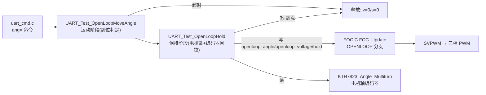

## 产品概述
在现有 STM32 电机驱动器固件中，把串口命令 `ang=<deg>`（开环角度转动）的行为从"到位即断电释放"改为"到位后以电弹簧方式保持当前角度"：到位后持续通电提供保持力矩，并用电机轴编码器监测偏差，偏离容差范围时自动回拉，保持 3 秒后停止（v=0、s=0）。

## 核心功能
- **到位后保持（电弹簧）**：`ang=<deg>` 转动到位后不再把电压/速度清零，而是保持通电、把电角度冻结在当前转子位置，形成电磁回复力，把转子钳在到位点附近（d 轴通电，与工程中已验证的 ALIGN 磁力定位同形态）。
- **持续保持力矩**：保持阶段使用可配置的保持电压（默认沿用本次运动电压 0.6V），不需要精确角度。
- **编码器偏差回拉**：以电机轴编码器角度为反馈，记录到位点；偏差超过 ±10°（电机轴，约输出端 ±0.8°）时，解除冻结、按低速度反向开环回拉，回到 ±3° 滞环内重新冻结保持。
- **定时释放**：从到位起保持 3000ms，随后释放（manual_voltage=0、manual_speed=0、target_speed=0、开环电压 0）。
- **安全保护**：保持与回拉期间持续刷新编码器、喂独立看门狗、维持串口非阻塞发送；回拉单次超时和总保持时长到点即退出，避免绕组长时间大电流发热；保持电压不超堵转保护安全范围。
- 更新 `ang=` 回显文案与 `help` 说明，标注"到位后保持 3000ms 再释放"。


## 技术栈
- 语言/平台：C99，STM32G4 + STM32 HAL（现有工程），无新增依赖。
- 复用现有模块：FOC 状态机（`Core/Src/FOC.C`、`Core/Inc/FOC.H`）、串口命令层（`Core/Src/uart_cmd.c`）、电机轴绝对编码器 `KTH7823`、保护 `Protect`。
- 复用的既有模式：ALIGN 的"固定电角度 + d 轴通电"磁力定位、`FOC_SetMode` 的"开环角度与转子电角度对齐"表达式、`UART_Test_OpenLoopMoveAngle` 的"按控制节拍积分判到位"方法。

## 实现思路
1. **新增"开环保持"标志，改由 FOC 层支持电弹簧**
   仅在命令层写角度会被 `FOC_Update` 覆盖，且零速时 V/f 公式把电压压到 `FOC_VOLT_BOOST=0.2V`，无法得到可调保持力矩。因此在 `FOC_State` 增加 `uint8_t openloop_hold`：
   - `FOC_Update` 电压斜坡处：`openloop_hold` 置位时 `openloop_voltage_ramp = foc.openloop_voltage`（不走 V/f，保持力矩可调）。
   - `FOC_Update` 开环分支：置位时不积分 `openloop_angle`（冻结），并令 `foc.Vd = openloop_voltage_ramp; foc.Vq = 0; foc.angle = foc.openloop_angle;`（复刻 ALIGN 的电弹簧形态，比 Vq 更贴合"静态保持"）。
   - `FOC_Init` 与 `FOC_SetMode` 出口统一清零 `openloop_hold`，保证任何模式切换都会退出保持，避免状态残留（爆炸半径控制）。

2. **保持点选取与回拉策略**
   到位后记录 `hold_mech = KTH7823_Angle_Multiturn`（电机轴多圈机械角），把 `foc.openloop_angle` 用与 `FOC_SetMode` 相同的表达式对齐到当前转子电角度并归一化，再置 `openloop_hold=1`、`FOC_SetOpenLoopVoltage(hold_vol)`。此时平衡点=到位点，转子被磁力钳住并具备回复力矩。
   - 极对数 21 → 电角度周期 17.14° 电机轴机械角；d 轴弹簧的稳定吸引域约 ±180 电角度 ≈ ±8.57° 电机轴，与用户选的 ±10° 容差匹配。
   - 偏差 `dev = (KTH7823_Angle_Multiturn - hold_mech) * encoder_direction`（正=朝正向偏离）。`|dev| > 10°` 判定"逃出"，执行回拉。
   
3. **回拉 = 一段短程开环运动（复用既有积分判到位方法）**
   回拉时 `openloop_hold=0` → 先重新对齐 `openloop_angle` 到当前转子电角度（使平衡点=当前位置，避免角度超一个极距后反向弹走）→ 令 `target_speed = -sign(dev) * PULL_SPEED`（低回拉速度，如 3 rad/s）→ 按 `pulled += target_speed_ramp * MOTOR_POLE_PAIRS * control_dt * tick_delta` 积分，直到 `|dev| <= 3°` 滞环（或符号翻转/单次回拉超时/保持总时长到点）→ 重新对齐并置 `openloop_hold=1` 继续冻结保持。滞环避免在死区边缘反复启停抖动。

4. **时间与资源**
   - 运动阶段沿用 `TEST_OL_MOVE_TIMEOUT_MS=5000` 超时；超时时跳过保持直接释放并返回 -2。
   - 保持阶段 `TEST_OL_HOLD_MS=3000`；总阻塞时间上限约 5s + 3s（含回拉，回拉单次限 1s）。
   - 阻塞循环内每 1ms 必须做：`KTH7823_UpdateAngle()`、`KTH7823_UpdateSpeed()`、`UART_Tx_Poll()`、`HAL_IWDG_Refresh(&hiwdg)`。前三者是硬性要求（否则 10ms 未刷新计数会触发 `FAULT_CODE_ENCODER_STALL`，且看门狗约 1s 会复位）。
   - 复杂度：保持循环 O(1)/ms，仅一次乘加与一次 `fabsf`；回拉内层同为 O(1)/ms，无动态内存、无浮点格式化。整个改动仅增加一个 `uint8_t` 字段，无额外 RAM/栈压力（主栈仅 1KB，辅助函数不放大数组）。

5. **性能与可靠性权衡**
   - 保持采用持续 DC 通电（冻结电角度下相电流仅受 R 限制），发热与电流随保持电压上升。默认保持电压取本次运动电压（0.6V，与 `ALIGN_VOLTAGE` 一致），由工程既有结论" >3V 会触发堵转保护"可推出 0.6V 下三相合成电流远低于 `STALL_CURRENT_LIMIT=45A`、I_rms 远低于 `I2T_NOMINAL_CURRENT=14A`，3s 保持安全；计划中把保持电压设成宏并限幅（如 ≤1.0V），便于按实测调整。
   - 保持期间转速≈0，`Protect_StallCheck` 只在 `i_mag>45A` 时才跳闸，正常保持不误触发。
   - 阻塞期间不处理 CAN，但 `enable` 已调用 `Protect_CommDisarm()` 关闭失联保护，无副作用。

## 实现要点（防回归）
- `main.c:338-339` 主循环每轮会执行 `FOC_SetOpenLoopVoltage(manual_voltage); foc.target_speed = manual_speed;`，但阻塞函数期间主循环不运行，故不冲突；释放后必须把 `manual_voltage/manual_speed/foc.target_speed/foc.target_speed_ramp` 一并清零，避免返回后残留给定。
- `FOC_SetOpenLoopVoltage()` 仅在 `foc.mode==FOC_STATE_OPENLOOP` 时生效（含 bus/2 限幅），保持阶段仍处 OPENLOOP，可直接用它设置保持电压。
- 冻结 `openloop_angle` 前必须先把 `target_speed_ramp` 清零，避免解除冻结瞬间角度突跳积分。
- `openloop_hold` 用 `uint8_t`，1 字节对齐，不破坏 `FOC_State` 现有字段布局语义；仅新增字段，不改既有字段。
- 复用现有 `KTH7823_Angle_Multiturn`（未滤波多圈角，闭环同源），不要用滤波后的 `KTH7823_Angle_Rad`（有约 12ms 群延迟）。
- 日志沿用现有串口非阻塞通道（`UART_SendString`），仅在状态切换时输出（start/hold/pull/release），避免刷屏。

## 架构设计
改动集中在两层，保持既有分层不变：



## 目录结构
```
doog_drive/
├── Core/
│   ├── Inc/
│   │   └── FOC.H        # [MODIFY] 在 FOC_State 中新增 uint8_t openloop_hold（开环保持标志）。
│   │                    #   目的：让命令层可请求"冻结电角度 + 固定电压保持"。放在 mode 字段附近，
│   │                    #   保持结构体语义清晰；注释说明置位语义与清零位置。
│   └── Src/
│       ├── FOC.C        # [MODIFY] 1) FOC_Init 中初始化 foc.openloop_hold = 0；
│       │                #   2) FOC_SetMode 出口统一 foc.openloop_hold = 0（任意切换都退出保持）；
│       │                #   3) FOC_Update 电压斜坡处：hold 置位时 openloop_voltage_ramp = foc.openloop_voltage；
│       │                #   4) FOC_Update 开环分支：hold 置位时冻结 openloop_angle，置 foc.Vd=openloop_voltage_ramp、
│       │                #      foc.Vq=0、foc.angle=openloop_angle；否则维持原积分+ Vq 逻辑。
│       └── uart_cmd.c    # [MODIFY] 1) 新增保持相关宏（保持时长/死区/滞环/回拉速度/回拉超时/保持电压）；
│                        #   2) 新增静态辅助：电角度归一化、UART_Test_OpenLoopHold(hold_vol) —— 冻结+对齐+持续通电+编码器死区回拉；
│                        #   3) UART_Test_OpenLoopMoveAngle 到位后改为调用保持阶段（运动超时则跳过保持），
│                        #      释放时清零 openloop_hold/manual_voltage/manual_speed/target_speed/target_speed_ramp 与开环电压；
│                        #   4) UART_Test_AngleCmd 回显文案与 help_msg 的 ang= 说明更新为"到位后保持 3s 再释放"。
```

## 关键代码结构（接口级）
```c
/* FOC.H：新增字段（1 字节） */
typedef struct {
    ...
    float openloop_angle;      // 开环模式下独立累加的电角度 (rad)
    float openloop_voltage;    // 开环模式下手动给定的电压幅值 (V)
    uint8_t openloop_hold;     // 1 = 开环保持：冻结 openloop_angle 且用 Vd 通电形成电弹簧；0 = 正常开环积分
    FOC_State_t mode;
    ...
} FOC_State;

/* uart_cmd.c：新增保持阶段（冻结 + 编码器死区回拉），签名保持内部静态 */
static void UART_Test_OpenLoopHold(float hold_vol);   // 阻塞执行，内部自带 3s 定时与回拉/超时保护
```


## Agent Extensions
### SubAgent
- **code-explorer**
  - Purpose: 在实现前做一次 medium 级影响面核查，确认 `foc.openloop_angle`、`foc.openloop_voltage`、`foc.target_speed_ramp`、`FOC_SetMode` 的全部读写点，以及 `dbg_monitor.c`、`fdcan_app.c` 是否直接依赖这些字段或被新增 `openloop_hold` 影响。
  - Expected outcome: 给出"待改动符号的全部引用清单 + 是否存在依赖开环行为的其它路径"的结论，确保新增标志不会影响闭环/FAULT/CAN 路径。

### Skill
- **lsp-code-analysis**
  - Purpose: 对 `FOC_State`、`FOC_SetMode`、`FOC_SetOpenLoopVoltage`、`UART_Test_OpenLoopMoveAngle` 做符号级引用/影响分析（find references / call hierarchy），精确定位新增字段与行为变更的爆炸半径。
  - Expected outcome: 产出精确的引用列表与调用层级，用于在计划执行时一次性改全所有需要同步清零/初始化的位置，避免遗漏导致的保持状态残留。
