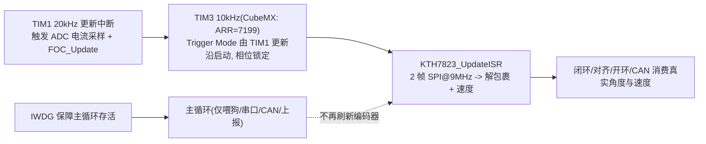

## 产品概述
把电机轴编码器（KTH7823）的角度/速度刷新从主循环移出，改由与电流采样同相位的固定频率中断完成，从根本上消除 20kHz 闭环控制使用"1ms 才更新一次的阶梯化角度"所导致的电流/转矩纹波与相位滞后。

## 核心功能
- 编码器角度/速度在 TIM3 中断内刷新，默认 10kHz（与 TIM1 更新/ADC 电流采样同相位），可通过 CubeMX 改一个数切到 20kHz。
- SPI1 时钟由 1.125MHz 提升到 9MHz（预分频 32 改 4），满足 KTH7823 的 T_SCK 最小 100ns；读取时序保持"两帧流水线 + 两次独立 CS 脉冲（间隔 >150ns）"。
- 主循环与启动对齐、开环悬停/回拉三处阻塞循环不再承担编码器刷新，只保留喂狗与串口发送。
- 失速/断线检测语义调整：主循环存活交由 IWDG，编码器改为"读数异常（连续 0x0000/0xFFFF）"有效性判据。
- 闭环仍使用真实的累积多圈角度作为反馈源，仅刷新率提高；对齐、开环悬停/回拉、CAN 相对角等语义不变；第二编码器 Encoder2 保持不启用。

## 约束
- 所有底层外设配置（TIM3 的分频/从模式、SPI1 预分频）必须由 CubeMX 生成，不得在代码里手写寄存器级配置或覆盖 Slave Mode。


## 技术栈
- 平台：STM32G474RB（LQFP64），Cortex-M4 裸机 C，STM32 HAL，Keil MDK，保留 CubeMX 生成风格。
- 时钟：HSE=8MHz → SYSCLK=HCLK=72MHz；APB1=72MHz（TIM3 时钟 72MHz）；APB2=36MHz（SPI1 时钟 36MHz）。
- 采样时基：TIM3（已由 CubeMX 建立），Slave Mode = Trigger Mode、Trigger Source = ITR0（=TIM1_TRGO）、Clock Source = Internal。仅需把 **Counter Period 由 65535 改为 7199**（72MHz/7200 = 10kHz）；切 20kHz 时改 3599。中断向量 `TIM3_IRQn`，抢占优先级 2。
- 相位对齐原理（本次关键结论）：HAL 在 Trigger Mode 下**不由软件置 CEN**（源码证据：`stm32g4xx_hal_tim.c:493-500`、`stm32g4xx_hal_tim_ex.c:365-370`，注释 "Enable the Peripheral, except in trigger mode where enable is automatically done with trigger"），CEN 由硬件在触发沿置位。故 TIM3 在 TIM1 的一次更新事件上被启动，其更新时刻落在 TIM1 的 20kHz 网格上；两者同源 72MHz、100µs 为 50µs 整数倍，因此**相位锁定且永不漂移**，无需 External Clock Mode 1。
- SPI：`hspi1`，16bit、CPOL=1/CPHA=1、NSS 软件控制；预分频 **32→4（9MHz）**，通过 CubeMX 的 SPI1 Parameter Settings 修改。
- 计时：沿用 `DWT->CYCCNT` @72MHz 做速度差分（无符号减法抗回绕）。
- NVIC（分组 4）：EXTI=0、TIM1=1、**TIM3=2**、USART3/FDCAN/DMA=3。TIM3 数值大于 TIM1，保证 20kHz 控制中断可抢占采样中断。

## 实现方案
1. **SPI 提速（CubeMX）**：SPI1 的 Baud Rate Prescaler 由 32 改为 4（9MHz ≤ 10MHz 上限）。两帧之间 CS 高电平 >150ns、末个 SCK 到 CS 拉高 >120ns（T_H）由现有 `HAL_GPIO_WritePin` 翻转开销（µs 级）天然满足；若后续改为 BSRR 直写才需显式插入 ≥11 个 CPU 周期延时。
2. **刷新入口单一化**：在 `KTH7823.c/h` 新增 `KTH7823_UpdateISR()`，内部依次调用现有 `KTH7823_UpdateAngle()` + `KTH7823_UpdateSpeed()`，供 TIM3 中断调用。
3. **TIM3 接入**：CubeMX 把 Counter Period 改为 7199（`tim.c` 同步生成）；`MotorControl_Init()` 内调用 `HAL_TIM_Base_Start_IT(&htim3)`（触发模式下 HAL 不置 CEN，交由硬件触发启动）；`HAL_TIM_PeriodElapsedCallback()` 增加 `htim3` 分支调用 `KTH7823_UpdateISR()`。`TIM3_IRQHandler` 已存在，无需改动。
4. **移除主循环依赖**：删除 5 处 `KTH7823_UpdateAngle/Speed` 调用（`main.c` 主循环 337-338、启动对齐阻塞循环 162-163；`uart_cmd.c` 239-240、257-258、332-333），保留其中的 `HAL_IWDG_Refresh()` 与 `UART_Tx_Poll()`。
5. **检测语义调整**：`encoder_update_count` 改由中断递增作为采样心跳；`Protect_EncoderStallCheck()` 改为读数有效性判据（ISR 内统计连续读到 0x0000/0xFFFF 达阈值即判失效，走既有 `FAULT_CODE_ENCODER_STALL` 流程），主循环存活交由 IWDG；同步更新 `Protect.h` 的阈值与注释。
6. **可观测性**：`DBG_Monitor_t` 增加采样计数、异常读数计数、断线标志，供 KEIL Watch 验证与调参。

## 性能与可靠性
- 单次读取：2 帧 @9MHz ≈ 3.6µs，加 HAL/CS 开销预计 10–18µs；叠加解包裹与 sin/cos/atan2 数学约 2–5µs。ISR 负载 10kHz 约 12–23%，20kHz 约 24–46%。若偏高，可把仅用于显示/对齐的滤波+atan2 部分移回主循环（需同步处理 ALIGN 使用的 `KTH7823_Angle_Rad` 来源）。
- 并发：中断内为单写者，TIM1 可抢占 TIM3；`KTH7823_Angle_Multiturn`/`KTH7823_Speed_Rads` 为 32 位对齐标量（volatile），先算后写避免撕裂。
- 耦合风险：TIM3 由 TIM1 更新事件启动后按内部时钟自由运行；若 TIM1 完全停止计数则采样停（现有故障分支只调 `HAL_TIM_PWM_Stop` 停通道、不停计数器，不受影响），需在注释中说明。
- 无回归面：闭环角度源仍为真实 `KTH7823_Angle_Multiturn`，`encoder_offset`/`encoder_direction` 语义与 mode=3 对齐结果不变。

## 架构与数据流


## 目录结构
```
doog_drive/
├── Core/
│   ├── Inc/
│   │   ├── kth7823.h        # [MODIFY] 新增 KTH7823_UpdateISR() 声明、异常读数阈值宏；保留原符号
│   │   ├── Protect.h        # [MODIFY] 调整编码器断线判据的阈值与说明（改为读数有效性）
│   │   └── dbg_monitor.h    # [MODIFY] DBG_Monitor_t 增加采样计数/异常读数计数/断线标志
│   └── Src/
│       ├── KTH7823.c        # [MODIFY] 新增 KTH7823_UpdateISR()（合并 UpdateAngle+UpdateSpeed）；CS 硬编码改用 ME_CS_GPIO_Port/ME_CS_Pin；增加异常读数统计与 Init 复位
│       ├── motor_control.c  # [MODIFY] MotorControl_Init 内 HAL_TIM_Base_Start_IT(&htim3)；HAL_TIM_PeriodElapsedCallback 增加 htim3 分支
│       ├── Protect.c        # [MODIFY] 改写 Protect_EncoderStallCheck 为读数有效性判据
│       ├── main.c           # [MODIFY] 移除主循环(337-338)与启动对齐阻塞循环(162-163)中的编码器调用
│       ├── uart_cmd.c       # [MODIFY] 移除三处阻塞循环(239-240/257-258/332-333)中的编码器调用（保留喂狗/发送）
│       └── FOC.C            # [MODIFY] DBG_Monitor_Update 填充采样计数/异常标志（FOC 角度源不改）
├── spi.c (Core/Src)         # [MODIFY via CubeMX] SPI1 BaudRatePrescaler 32 -> 4 (9MHz)
├── tim.c (Core/Src)         # [MODIFY via CubeMX] htim3.Init.Period 65535 -> 7199 (10kHz)
└── Drive.ioc                # [MODIFY via CubeMX] 同步 SPI1 预分频与 TIM3 Period
```

## 关键代码结构
```c
/* kth7823.h */
#define KTH7823_RAW_FAULT_LIMIT  8u    /* 连续异常读数次数判失效（示例，按实测调整） */
void KTH7823_UpdateISR(void);          /* TIM3 中断内调用：内部=UpdateAngle + UpdateSpeed */
extern volatile uint32_t encoder_update_count;   /* 改由中断递增（采样心跳） */
extern volatile uint16_t kth7823_raw_fault_cnt;  /* 连续读到 0x0000/0xFFFF 的次数，供保护判定 */

/* motor_control.c */
void HAL_TIM_PeriodElapsedCallback(TIM_HandleTypeDef *htim) {
    if (htim->Instance == TIM1) { CurrentSense_Update(); if (motor_ready) FOC_Update(); control_tick++; }
    else if (htim->Instance == TIM3) { KTH7823_UpdateISR(); }
}
```

## 实施注意
- 中断优先级必须保持 TIM3(2) 大于 TIM1(1)，否则采样会延迟控制节拍。
- TIM3 的 CH1/CH2/CH3 与 SPI1（PA6/PA7）、ME2_CS（PB0）复用引脚，务必不要启用任何 TIM3 通道。
- CubeMX 重新生成会覆盖 spi.c/tim.c/stm32g4xx_it.c/main.c，因此 SPI1 预分频与 TIM3 Period 必须在 CubeMX 里改，业务代码改动只能落在 USER CODE 段。
- SPI 读取移入中断后，`HAL_SPI_TransmitReceive` 的 100ms 超时不再威胁主循环，但需确认中断内不长时间阻塞（9MHz 下正常 10–18µs）。
- 三处阻塞循环移除编码器调用后，`ENCODER_STALL_TIMEOUT_TICKS` 原有"主循环阻塞会误判"的问题随之消失，需同步更新 Protect.h 注释与阈值含义。


## Agent Extensions
### Skill
- **lsp-code-analysis**
  - Purpose: 语义化定位 `KTH7823_UpdateAngle` / `KTH7823_UpdateSpeed` / `KTH7823_Angle_Multiturn` / `KTH7823_Angle_Rad` / `KTH7823_Speed_Rads` / `encoder_update_count` 的全部定义与引用，产出精确的调用点与消费点清单。
  - Expected outcome: 确认恰好 5 处刷新调用需要移除，且其余消费点（FOC 闭环、对齐、开环悬停/回拉、CAN 相对角、失速检测）不受影响，避免漏删或误删。
### SubAgent
- **code-explorer**
  - Purpose: 交叉核实 TIM3 已在 CubeMX/工程中完整接入（tim.c/tim.h/中断向量/NVIC 优先级/main.c 初始化顺序）以及 `HAL_TIM_PeriodElapsedCallback` 与 `MotorControl_Init` 的现有实现和 CubeMX 生成文件边界。
  - Expected outcome: 确认只需改 `htim3.Init.Period` 并补 `HAL_TIM_Base_Start_IT(&htim3)` 与 ISR 分支，避免遗漏中断处理函数或初始化调用。

