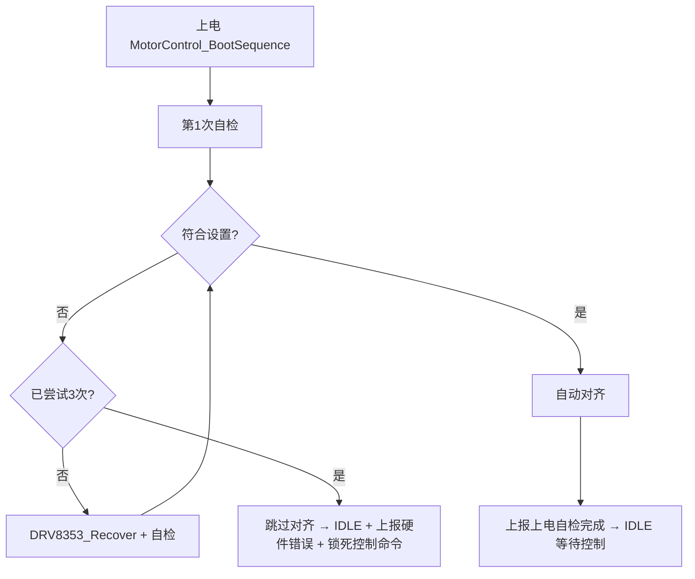

# doog_drive

基于 **STM32G474** 的 **FOC 关节电机驱动器固件**。每块驱动板驱动一台带减速器的无刷电机，
接收上位机（RK3588S）通过 **CAN** 下发的控制指令，支持开环 / 闭环速度 / 闭环位置 / 转矩 /
对齐等多种运行模式，并内置完整的软件保护与故障自恢复机制。

## 项目总览

### 目标应用

四足机器人关节驱动：上位机 RK3588S 带两路 FDCAN，每路挂 6 个关节电机（单侧前后两腿 × 每腿 3 关节），
共 **12 个节点**。所有驱动板硬件完全相同，只有 `NODE_ID` 宏不同，分别编译烧录 1~12 号固件。

### 主要功能

| 功能 | 说明 |
|---|---|
| **FOC 矢量控制** | Clark / Park 变换 + 七段式 SVPWM，电流环 **20kHz**（TIM1 更新中断，双采样双更新，`control_dt = 50µs`） |
| **多模式运行** | IDLE / 开环 / 闭环速度 / 闭环位置 / 转矩，以及上电自动**转子对齐**（两步磁力定位，自动求零点偏移与方向） |
| **闭环级联** | 位置环 → 速度环 → 电流环（d/q 双轴）三级级联，位置式 PID（微分先行 + clamping 抗积分饱和） |
| **开环「转角度 + 悬停」** | 按开环方式转到减速器输出端指定角度，到位后进入"电弹簧"悬停保持（`RUN → HOLD → PULL` 子状态机） |
| **缓启动** | 速度斜坡（80 rad/s²）+ 开环 V/f 带低速升压，防止上电冲击 |
| **CAN 总线控制** | FDCAN2 @ **1Mbps**，命令帧 / 状态反馈帧 / 开环动作状态帧，多节点 ID 编址，总线错误与 BusOff 自恢复 |
| **串口调试** | USART3 @ **115200**，命令行支持在线查看状态、修改模式 / 速度 / 电压 / 转矩、在线调 PID、CAN 诊断、故障读取 |
| **软件保护** | 堵转、编码器失效、通讯失联、过温、母线过压 / 欠压、超速、相电流峰值、I²t 热积累、位置跟随误差、软限位共 11 项，另有 DRV8353 硬件故障（nFAULT） |
| **故障恢复** | 指数退避（2s→4s→8s→16s 封顶）+ 条件复检，自动重启回到开环；阻塞式驱动恢复放在主循环执行 |
| **可观测性** | `DBG_Monitor_t dbg` 调试快照（Keil Watch 一次展开看全部状态）、编码器采样心跳、CAN 运行统计 |

> 注：`FOC.H` 中 `FOC_CLOSEDLOOP_ENABLE = 0`，当前固件处于**硬件验证/开环调试阶段**，闭环代码已就绪但默认未启用。

### 主控与外设资源

| 项目 | 配置 |
|---|---|
| **MCU** | STM32G474RBT6（LQFP64，Cortex-M4F，128KB Flash / 128KB RAM） |
| **系统时钟** | HSE 8MHz → PLL → **SYSCLK 72MHz**；HCLK 72M / PCLK1 72M / PCLK2 36M |
| **TIM1** | 三相 PWM，中心对齐模式1，PSC=0 / ARR=3599 → **10kHz PWM**、**20kHz 更新中断**，CH1/2/3（PA8/PA9/PA10），死区 0（由 DRV8353 内部 50ns 死区承担），TRGO=UPDATE（供 ADC 触发） |
| **TIM3** | 编码器刷新，Trigger Mode + ITR0(=TIM1_TRGO) 由 TIM1 首个更新沿启动后自由运行，ARR=7199 → **10kHz** 调用 KTH7823 刷新 |
| **ADC1** | 12 位扫描 4 通道，`T1_TRGO` 上升沿触发，DMA 循环：CH2(PA1)=A 相电流、CH3(PA2)=B 相电流、CH8(PC2)=母线电压、CH4(PA3)=MOS 温度 |
| **ADC2** | 12 位单通道 CH12(PB2)，同 `T1_TRGO` 触发：线圈 NTC 温度 |
| **DMA1** | Ch1/Ch2 = ADC1/ADC2 循环搬运；Ch3 = USART3_TX、Ch4 = USART3_RX（循环） |
| **SPI1** | 主，16bit，CPOL=High，预分频 4 → **9 Mbit/s**：**KTH7823 磁编码器**（CS = `ME_CS` PC4） |
| **SPI2** | 主，16bit，CPOL=Low，预分频 32 → **2.25 Mbit/s**：**DRV8353 栅极驱动**（CS = `DRV_CS` PC6） |
| **SPI3** | 主，16bit，CPOL=High，预分频 32 → **2.25 Mbit/s**：**第二编码器**（减速器输出端，CS = `ME2_CS` PB0） |
| **FDCAN2** | 经典帧 / 正常模式，Prescaler=9、TS1=5、TS2=2、SJW=1 → **1 Mbps**（采样点 75%），PB5(RX)/PB6(TX) |
| **USART3** | **115200-8N1**，PB10(TX)/PB11(RX)，RX DMA 循环 + IDLE 空闲中断收帧 |
| **IWDG** | 独立看门狗，预分频 256、Reload=125 → 超时 **约 1s**（主循环 1ms 周期喂狗） |
| **GPIO / EXTI** | `ENABLE`(PA11，DRV8353 使能，低有效默认关)、`nFAULT`(PA12，下降沿 EXTI，优先级最高 0)、`LED`(PB9，低点亮)、`PWM_COTR`(PB12，DRV8353 PWM 控制脚)、三个片选 |
| **中断优先级** | EXTI15_10 = 0 > TIM1(20kHz) = 1 > TIM3(10kHz) = 2 > DMA/FDCAN/USART3 = 3 |
| **延时** | `dwt_delay.c` 基于内核 DWT CYCCNT 的 µs/ms 精确延时（替代 `HAL_Delay`） |

### 主要外置器件

| 器件 | 型号 | 作用与关键参数 |
|---|---|---|
| 栅极驱动 | **DRV8353F**（SPI 版） | 3x PWM 模式、过流关断全部半桥；TDRIVE 1000ns，灌电流>拉电流抗直通；OCP 死区 50ns / 锁存模式 / 1.0V VDS 阈值；**内部 CSA 禁用**（改用外部 INA240）；软件可读回自检（`DRV8353_SelfCheck`） |
| 电流采样 | **INA240A1** ×2 | A/B 相各一路，增益 20，采样电阻 1mΩ，VREF 偏置 1.65V（3.3V/2），理论上量程约 ±82A；C 相由基尔霍夫合成；上电 64 次平均求零偏 |
| 磁编码器 | **KTH7823** | 电机轴角度，SPI1 读数（两帧连发取第二帧），**16 位**分辨率（65536 刻度/圈），sin/cos 一阶低通 + atan2 + 多圈解包裹；连续读到 0x0000/0xFFFF 达 8 次判失效 |
| 第二编码器 | **待定**（`encoder2.c` 为框架 + TODO 占位） | 减速器输出端角度，SPI3，作为位置环角度源 |
| 功率 MOSFET | 见 `数据手册/MOSFET.pdf` | 驱动设计按 Qg ≈ 37nC 选取驱动电流 |
| 电机 | 21 极对、减速比 12.5、额定 14A | 参数见 `FOC.H` |

数据手册齐全：`数据手册/{STM32,drv8353f,ina240,KTH,MOSFET}.pdf`。

### 软件模块结构（`Core/`）

| 文件 | 职责 |
|---|---|
| `main.c` | 时钟 / 外设初始化、主循环调度（仅调用封装函数 `MotorControl_BootSequence()` / `MotorControl_BootErrorLed()`）、nFAULT EXTI 回调、故障码上报 |
| `motor_control.c` | 计算 `control_dt`、初始化各驱动、TIM1/TIM3 中断回调（20kHz 跑电流采样 + `FOC_Update`，10kHz 刷新编码器）；**上电启动序列**（自检重试 → 对齐 → IDLE，含硬件错误锁死门控与 LED 指示） |
| `FOC.C` | FOC 核心：状态机、变换、SVPWM、三级 PID 级联、开环转角度/悬停、故障退避与恢复握手、LED |
| `PID.c` | 通用位置式 PID（微分先行 + clamping 抗饱和） |
| `Protect.c` | 全部软件保护巡检 `Protect_FOC()`、统一停机入口 `Protect_StopPWM()` |
| `sense.c` | ADC → 物理量换算（三相电流 / 母线电压 / NTC 温度）、零偏标定 |
| `DRV8353.C` | DRV8353F SPI 读写、寄存器配置、清故障 / 恢复 / 自检 |
| `KTH7823.c` | 电机轴编码器角度与速度读取、滤波、多圈解包裹 |
| `encoder2.c` | 第二（输出端）编码器角度 / 速度（芯片待定） |
| `fdcan_app.c` | CAN 命令解析、状态反馈、多节点 ID、错误 / BusOff 监测、接收队列 |
| `uart_cmd.c` | 串口命令行解析、状态打印、PID 在线调参、对齐结果上报 |
| `dwt_delay.c` / `dbg_monitor.h` | 精确延时 / Keil Watch 调试快照 |
| `tim.c` `adc.c` `dma.c` `spi.c` `fdcan.c` `usart.c` `iwdg.c` `gpio.c` | 各外设初始化（CubeMX 生成） |

### 控制与保护要点

- **状态机** `FOC_State_t`（扁平 7 态，**枚举值即对外统一编号**）：
  `0`IDLE `1`OPENLOOP `2`ALIGN `3`TORQUE（闭环力矩）`4`SPEED（闭环速度）`5`POSITION（闭环位置）`6`FAULT。
  闭环三态按**级联深度递增**（`TORQUE=3 < SPEED=4 < POSITION=5`），故直接用 `foc.mode >=` 判深度：
  `TORQUE`=仅电流环 / `SPEED`=+速度环 / `POSITION`=+位置环。
- **模式编号**：串口 / CAN / 上报 / 保护共用同一套，且**直接使用 `(int)foc.mode`**，不再有任何映射函数。
- **保护项**：堵转(>45A 且转速≈0)、编码器失效、通讯失联(CAN 心跳 100ms 超时)、过温(90℃ 关断 / 70℃ 恢复)、
  母线过压(>32V)、欠压(<16V)、超速(230 rad/s)、单相峰值(55A)、I²t 热积累、位置跟随误差、软限位，
  外加 DRV8353 硬件 nFAULT。
- **故障码** `FAULT_CODE_*`：0 无 / 1 硬件 / 2 堵转 / 3 编码器 / 4 过温 / 5 过压 / 6 欠压 / 7 超速 /
  8 相过流 / 9 I²t / 10 位置误差 / 11 软限位 / 12 通讯超时。
- **恢复策略**：`FOC_STATE_FAULT` 指数退避（`2^(n-1) × 2s`，封顶 16s），到点后按温度 / 母线 / 转速 / I²t
  四项判据复检，通过则自动恢复开环；阻塞式 `DRV8353_Recover()` 拆到手握手（中断判定 → 主循环执行 → 中断收尾），
  避免在 20kHz 控制中断里长时间丢拍。

### 通信协议

**CAN（FDCAN2 @1Mbps，标准帧）**

- 命令帧 ID = `0x100 + NODE_ID`（0x101~0x10C），反馈帧 ID = `0x200 + NODE_ID`，开环状态帧 ID = `0x300 + NODE_ID`。
- 命令码（数据区 byte0）：`0x01` 速度、`0x02` 电压、`0x03` 模式、`0x04` 方向、`0x05` 转矩、`0x06` 位置、
  `0x07` 开环转角度并悬停、`0x08` 心跳、`0x09` 查开环状态、`0x10` 请求反馈。
- 完整字节编码、示例帧与上位机（Linux SocketCAN / python-can）示例见下文
  [CAN 上位机控制指令说明](#can-上位机控制指令说明)。

**串口（USART3 @115200）**：`help` `fault` `v=` `s=` `t=` `mode=` `dir=` `status` `can` `log=`
`pid [ring Kp Ki Kd]` `enable` `disable` `ang=`（行尾 `\r`/`\n`）。

### 目录结构

```
doog_drive/
├─ Core/           应用与驱动源码（Src / Inc）
├─ Drivers/        STM32G4 HAL 与 CMSIS
├─ Middlewares/    中间件
├─ MDK-ARM/        Keil MDK 工程（Drive.uvprojx）
├─ 数据手册/        器件数据手册（STM32 / DRV8353F / INA240 / KTH / MOSFET）
├─ Drive.ioc       STM32CubeMX 工程配置
└─ README.md       项目总览 + CAN 协议说明 + 更新记录
```

### 开发与构建

- **工具链**：Keil MDK-ARM V5.32（ARMCLANG V6.23），链接 ARM DSP 数学库 `arm_cortexM4lf_math.lib`。
- **构建**：用 Keil 打开 `MDK-ARM/Drive.uvprojx` 编译；修改外设配置用 STM32CubeMX 打开 `Drive.ioc`。
- **烧录**：SWD（PA13/PA14）。**烧录前按关节修改 `fdcan_app.h` 的 `NODE_ID`（1~12）**。
- **调试**：Keil Watch 添加变量 `dbg` 一次查看全部运行状态；串口 `status` / `can` 做在线诊断。

## CAN 上位机控制指令说明

> 适用对象：STM32G474 关节电机驱动器（FOC 固件）
> 面向读者：上位机侧（RK3588S / 主控）开发与调试人员
> **本文重点：上位机如何通过 CAN 发送控制指令。**

---

### 1. 概述与当前启用状态

- 下位机通过 **FDCAN2** 与上位机通讯，采用 **经典 CAN（Classic CAN，非 CAN FD）**、**11 位标准帧**。
- 每块驱动板有一个**编译期固定**的节点号 `NODE_ID`（1 ~ 12）。
- 通讯是**一问一答式**：
  - 上位机向 `0x100 + NODE_ID` 发送**命令帧**（下称"指令"）；
  - 下位机向 `0x200 + NODE_ID` 发送**状态反馈帧**（`0x10` 的响应）；
  - 下位机向 `0x300 + NODE_ID` 发送**开环动作状态帧**（`0x09` 的响应，独立帧 ID）；
  - 节点号编码进帧 ID，由硬件过滤器自动区分，同一总线上的多个电机互不干扰。

> ✅ **当前启用状态（已启用）**
> 应用层代码已实现，且 `Core/Src/main.c` 中初始化与主循环调用**均已启用**，**无需再手动取消注释**：
> - `USER CODE BEGIN 2` 中的 `FDCAN_App_Init();`
> - 主循环中的 `FDCAN_App_Process();`
> - 总线错误监测（Error Warning / Error Passive / Bus Off / 协议错误）与**总线关闭（BusOff）自动恢复**同样已启用，见 [2.1](#21-总线错误监测与-busoff-自动恢复)。
>
> 核对方法见 [第 9 章](#9-附录can-的启用与检查)。

---

### 2. 总线与硬件参数

| 项目 | 值 | 说明 |
|---|---|---|
| 外设 | **FDCAN2** | |
| 引脚 | **PB5 = FDCAN2_RX**，**PB6 = FDCAN2_TX** | AF9 |
| 时钟源 | PCLK1 = **72 MHz** | HSE 8MHz × PLLN18 / PLLR2 |
| 帧格式 | **经典 CAN** | 非 CAN FD，数据段 ≤ 8 字节 |
| 工作模式 | Normal | 正常收发 |
| 波特率 | **1 Mbps** | Prescaler=9，TS1=5，TS2=2（采样点 75%） |
| 自动重传 | **关闭** | 发送失败不自动重传，需上位机重发/超时处理 |
| 协议异常处理 | **关闭**（`ProtocolException=DISABLE`） | 协议异常**不**自动进入总线关闭；固件另开启**诊断用**协议错误中断，仅累计错误次数 |
| 错误状态中断 | **已开启** | Error Warning / Error Passive / Bus Off 状态变化时进中断记录标志与计数 |
| 总线关闭自动恢复 | **已启用** | 主循环检测到 BusOff 后 `Stop → Start` 自动重试恢复，详见 [2.1](#21-总线错误监测与-busoff-自动恢复) |
| 标准过滤器个数 | 1 | 掩码模式精确匹配 `0x100 + NODE_ID`，投递 RX FIFO0 |
| 全局过滤器 | **拒绝不匹配帧** | `NonMatchingStd/Ext = Reject`，远程帧同样拒绝：其他节点的命令帧不会进入本节点 |
| 接收队列 | 16 帧深（软件） | 中断内一次读空 RX FIFO0 入队，主循环按到达顺序全部执行，突发指令不互相覆盖 |
| 中断 | `FDCAN2_IT0` / `FDCAN2_IT1` | 优先级均 3 |
| 中断线分工 | `IT0` = FIFO0 接收；`IT1` = Error Warning / Error Passive / Bus Off / 协议错误 | G4 的 `ILS.PERR` 分组**本身就覆盖 Warning Status 与 Bus_Off Status**，所以 EW/BO 实际走 `IT1`（不是 `IT0`）；两个 `IRQHandler` 都调用 `HAL_FDCAN_IRQHandler` 且两条 NVIC 线均已使能，功能等价 |

> 波特率换算：`f_bit = 72MHz / (Prescaler × (1 + TS1 + TS2)) = 72e6 / (9 × 8) = 1 Mbps`。
> 上位机侧请将 CAN 控制器配置为 **1 Mbps**、经典帧，否则收发异常。

#### 2.1 总线错误监测与 BusOff 自动恢复

下位机对总线错误做了**监测 + 自愈**，上位机联调时需了解其行为：

- **错误分级监测**（状态变化时进中断，仅记录、不阻塞）：Error Warning（TEC>96 或 REC>96）、Error Passive（TEC>127 或 REC>127）、Bus Off（节点离线）。
- **诊断变量**（固件内部维护）：
  - `fdcan_error_flags`：当前错误标志位，bit0 = 错误警告(EW)、bit1 = 错误被动(EP)、bit2 = 总线关闭(BO)；
  - `fdcan_tec` / `fdcan_rec`：发送/接收错误计数；
  - `fdcan_busoff_count`：累计进入总线关闭次数；
  - `fdcan_proto_err`：协议错误（仲裁段/数据段）累计次数。
  - ⚠️ 以上变量**当前不经 CAN 上报**：`0x200` / `0x300` 反馈帧均无对应字段，只能通过本地调试（串口/调试器）读取，上位机不要按不存在的字段解析。
- **总线关闭自动恢复流程**（在 `FDCAN_App_Process()` 中，主循环执行）：
  1. 检测到 BO 标志 → 先清标志（防死循环）；
  2. `HAL_FDCAN_Stop()` → `HAL_FDCAN_Start()`，由硬件等待总线空闲后自动退出总线关闭；
     - `Stop` 的返回值被**忽略**：`State != BUSY` 时它必然返回失败，但只要成功进入 INIT，随后的 `Start` 即可把外设拉回运行态；
     - `HAL_FDCAN_Start` 本身**没有超时等待**（只清 `CCCR.INIT` 后立即返回），失败只可能是 `State` 异常，**不会是"总线繁忙"**；
  3. 恢复成功则重新激活接收/错误中断通知；
  4. 若 `Start` 失败（`State` 异常，例如 `Stop` 超时被置为 `ERROR`），改用 `HAL_FDCAN_Init()` + `FDCAN_App_Init()` **整外设重新初始化**（过滤器、全局过滤器、中断线一并重配），从根上避免恢复逻辑永久卡死；
  5. 若最终仍未进入 `BUSY` 运行态，重新置回 BO 标志，**下个主循环周期继续重试**。
- **对上位机的影响**：节点处于 BusOff 期间**完全不收发**；恢复瞬间与重试期间发出的帧可能丢失。关键指令（尤其 `0x07` 类动作命令）建议做重发或按反馈帧确认（见 [第 8 章](#8-注意事项与常见坑)）。

---

### 3. 节点编址

- 节点号：`NODE_ID`，取值 **1 ~ 12**，在 `Core/Inc/fdcan_app.h` 中 `#define NODE_ID 1`。
- 设计上两路 CAN 各挂 6 个关节，节点号全局唯一。

| 帧方向 | 帧 ID 计算 | 取值范围（NODE_ID=1~12） |
|---|---|---|
| 命令帧（上位机 → 电机） | `0x100 + NODE_ID` | `0x101` ~ `0x10C` |
| 状态反馈帧（电机 → 上位机） | `0x200 + NODE_ID` | `0x201` ~ `0x20C` |
| 开环动作状态帧（电机 → 上位机） | `0x300 + NODE_ID` | `0x301` ~ `0x30C` |

**过滤规则（下位机侧，三重保护）**：

1. **硬件过滤器**：仅接收 `CMD_FRAME_ID = 0x100 + NODE_ID` 的帧（掩码模式，`FilterID2 = 0x7FF` 全位精确匹配），投递到 RX FIFO0；
2. **全局过滤器**：不匹配任何过滤器的帧（含扩展帧、远程帧）一律**拒绝**，不会进入接收队列；
3. **接收中断内复核帧 ID**：只处理 `CMD_FRAME_ID` 的帧。

因此**发错 ID 的帧会被下位机直接丢弃**；同一总线上其他节点的帧既不执行、也不刷新本节点的心跳，**不会互相"串台"**。

**接收队列（突发多帧不再互相覆盖）**：接收中断把每一帧放入 16 帧深的软件队列，主循环按**到达顺序**逐条执行完所有积压帧，详见 [4.1](#41-统一帧格式) 与 [8](#8-注意事项与常见坑) 第 15 条。

---

### 4. 上位机发送控制指令（重点）

#### 4.1 统一帧格式

所有控制指令使用**同一种帧格式**：

| 项 | 要求 |
|---|---|
| 帧类型 | 数据帧 |
| ID 类型 | **标准帧（11 位 ID）** |
| ID 值 | `0x100 + NODE_ID` |
| 数据长度 | **DLC = 8（必须固定 8 字节）** |
| 字节 0 | **命令码** |
| 字节 1 ~ 7 | 命令参数（**小端，低字节在前**）；未用到的字节填 `0` |

> 📌 **建议固定发满 8 字节（DLC = 8）**，未用到的字节填 `0`。固件侧已对短帧补零（DLC < 8 时未用字节按 `0` 解析，不再是上一帧残留数据），但仍建议统一发满 8 字节；`0x07` 另有 `DLC ≥ 3` 的短帧保护，DLC 过小会被直接忽略。
>
> 📌 **可连发，但仍建议留间隔**：下位机接收侧已改为**队列化**（16 帧深），`0x03` 切模式 + `0x02` 设电压 + `0x07` 转角度这类连发**不会再互相覆盖**，且严格按到达顺序执行。不过仍建议**逐条发送、间隔 ≥2 ms**（或收到反馈后再发下一条）：降低总线瞬时负载，避免 3 级 TX FIFO 溢出导致反馈帧被丢弃。

#### 4.2 命令码总表

| 命令码 | 宏名 | 含义 | 参数编码 | 单位 |
|---|---|---|---|---|
| `0x01` | `CMD_SET_SPEED` | 设置目标速度 | byte1-2 = `int16` | rad/s **×10** |
| `0x02` | `CMD_SET_VOLTAGE` | 设置开环电压 | byte1-2 = `int16` | V **×100** |
| `0x03` | `CMD_SET_MODE` | 切换控制模式 | byte1 = `uint8` | 见下 |
| `0x04` | `CMD_SET_DIRECTION` | 设置方向 | byte1 = `uint8` | 0=正转，1=反转 |
| `0x05` | `CMD_SET_TORQUE` | 设置目标转矩 | byte1-2 = `int16` | Nm **×100** |
| `0x06` | `CMD_SET_POSITION` | 设置目标位置 | byte1-4 = `int32` | rad **×10000** |
| `0x07` | `CMD_SET_OPENLOOP_ANGLE_HOLD` | 开环转到指定输出端角度并悬停保持 | byte1-2 = `int16` | 度 **×10** |
| `0x08` | `CMD_HEARTBEAT` | 心跳（维持联机，不改变运行状态） | 无 | — |
| `0x09` | `CMD_GET_OL_STATUS` | 查询开环动作状态 | 无 | — |
| `0x10` | `CMD_GET_STATUS` | 请求状态反馈 | 无 | — |

> ⚠️ `0x01` / `0x02` / `0x07` 受**开环门控**约束，只在开环模式下生效，详见 [4.5 开环门控规则](#45-开环门控规则重要行为变更)。

**`0x03` 模式编号（byte1）**

| 值 | 模式 | 说明 |
|---|---|---|
| `0` | IDLE | 空闲，无输出 |
| `1` | 开环 | 开环电压/速度驱动 |
| `2` | 对齐 | 转子两步对齐 |
| `3` | 闭环力矩 | 直接给定 Iq |
| `4` | 闭环速度 | 速度环 → 电流环 |
| `5` | 闭环位置 | 位置环 → 速度环 → 电流环 |
| `6` | 故障 | 仅出现在**反馈 byte5**（命令 `0x03` 不接受 `6`） |

> 📌 上表各值**就是 `FOC_State_t` 枚举值本身**，也被 [5.1 状态反馈帧](#51-状态反馈帧0x10-的响应0x200--node_id) 的 **byte5** 直接使用：下位机**直接写入 `(int)foc.mode`**，无需任何转换函数，**与命令 `0x03` byte1 完全一致**，上位机可直接用同一套编号比较/回填。

#### 4.3 逐条命令的字节编码

所有数值均为**有符号**、**小端（低字节在前）**、**二进制补码**。

##### 4.3.1 `0x01` 设置目标速度（int16，rad/s ×10）

```
byte0 = 0x01
byte1 = (int16_val >> 0) & 0xFF
byte2 = (int16_val >> 8) & 0xFF
byte3..byte7 = 0
其中 int16_val = 目标速度(rad/s) × 10
```
- 例：目标 `10.0 rad/s` → `10 × 10 = 100 = 0x0064` → `byte1=0x64, byte2=0x00`

##### 4.3.2 `0x02` 设置开环电压（int16，V ×100）

```
byte0 = 0x02
byte1..2 = int16(电压(V) × 100)，小端
```
- 例：`0.6 V` → `0.6 × 100 = 60 = 0x003C` → `byte1=0x3C, byte2=0x00`
- **受开环门控**：仅在开环模式（`mode = 1`）生效，非开环时静默忽略（见 [4.5](#45-开环门控规则重要行为变更)）。
- **`0` 的语义**：发 `0x02` 且电压为 `0`（`byte1=0x00, byte2=0x00`）会**释放**正在进行的"转角度/悬停保持"动作（见 4.3.7），并把电压、速度归零。

##### 4.3.3 `0x03` 设置控制模式（uint8）

```
byte0 = 0x03
byte1 = 模式编号（0~5，见上表）
```
- 例：切到开环 → `byte1 = 0x01`

##### 4.3.4 `0x04` 设置方向（uint8）

```
byte0 = 0x04
byte1 = 0x00（正转）或 0x01（反转）
```
- 实现：对当前速度给定取符号（正转取 |v|，反转取 -|v|）。一般设置速度时可带符号，此命令用于不改变幅值地翻转方向。

##### 4.3.5 `0x05` 设置目标转矩（int16，Nm ×100）

```
byte0 = 0x05
byte1..2 = int16(转矩(Nm) × 100)，小端
```
- 例：`1.0 Nm` → `100 = 0x0064` → `byte1=0x64, byte2=0x00`

##### 4.3.6 `0x06` 设置目标位置（int32，rad ×10000）

```
byte0 = 0x06
byte1 = (int32_val >> 0)  & 0xFF
byte2 = (int32_val >> 8)  & 0xFF
byte3 = (int32_val >> 16) & 0xFF
byte4 = (int32_val >> 24) & 0xFF
byte5..byte7 = 0
其中 int32_val = 目标位置(rad) × 10000
```
- 例：`1.0 rad` → `10000 = 0x00002710` → `byte1=0x10, byte2=0x27, byte3=0x00, byte4=0x00`

##### 4.3.7 `0x07` 开环转到指定输出端角度并悬停保持（int16，度 ×10）

```
byte0 = 0x07
byte1 = (int16_val >> 0) & 0xFF
byte2 = (int16_val >> 8) & 0xFF
byte3..byte7 = 0
其中 int16_val = 目标输出端角度(度) × 10   （有符号：正=正转，负=反转；0 视为无效被忽略）
```
- 角度是**相对当前输出端位置**的相对量（非绝对零点）。
- **必须先处于开环模式**（`0x03` byte1=1），否则本条指令会被静默忽略（见 [4.5](#45-开环门控规则重要行为变更)）。
- **短帧/零值保护**：`DLC < 3` 时直接忽略；角度值 `0` 视为无效、直接忽略（不驱动、不改状态）。
- 运动速度/励磁电压复用 `0x01`/`0x02` 的当前设定；未设定时用缺省值（`5 rad/s` / `0.6 V`）。
- 命令后：按当前开环方式转动 → 到位后进入"电弹簧"悬停保持。

**动作参数与边界（源码宏见 `Core/Inc/FOC.H`）**

| 项 | 值 | 说明 |
|---|---|---|
| 减速比 | `GEAR_RATIO_OUT2MOTOR = 12.5` | 输出端 → 电机轴；指令角度按此折算为电机轴电角度 |
| 缺省运动速度 | `FOC_OL_DEFAULT_SPEED = 5 rad/s` | 未设 `0x01` 时使用（电机轴） |
| 缺省电压 | `FOC_OL_DEFAULT_VOLTAGE = 0.6 V` | 未设 `0x02` 时使用 |
| 悬停/回拉电压上限 | `FOC_OL_HOLD_VOLTAGE_MAX = 0.6 V` | 悬停电压 = min(运动电压, 0.6 V)：运动电压更高时悬停被钳到 0.6 V，保持力矩与发热按此上限 |
| 运动阶段超时 | `FOC_OL_MOVE_TIMEOUT_MS = 5000 ms` | **5 s 内未转够角度则直接断电释放**（不会进入悬停） |
| 保持偏差死区 | `FOC_OL_HOLD_BAND_DEG = ±10°`（电机轴） | 超出即触发编码器回拉，≈ 输出端 ±0.8° |
| 回拉滞环 | `FOC_OL_HOLD_HYST_DEG = ±3°`（电机轴） | 回到该范围内即重新冻结保持，≈ 输出端 ±0.24° |
| 回拉速度 | `FOC_OL_HOLD_PULL_SPEED = 3 rad/s`（电机轴） | 低速回拉，避免越过到位点 |
| 单次回拉超时 | `FOC_OL_HOLD_PULL_TIMEOUT_MS = 1000 ms` | 超时即重新冻结保持 |

- **到位判定方式**：按**指令电角度积分**（`|速度给定| × 极对数 × 控制周期` 递减剩余角度）判到位，**不依赖编码器实测**；因此到位时刻与实际机械位置可能存在负载/间隙误差。
- **运动超时**：5 s 内未转够设定角度（如角度过大、负载过重堵转），会**直接断电释放**，状态帧 `0x300` byte0 回到 `0`，不会停在悬停态。
- **悬停不计时自动释放，会一直保持**；释放条件（满足任一即可）：
  1. 发送 `0x02` 且电压为 `0`（`v=0`）——**显式释放**；
  2. 发送 `0x03` 切换到非开环模式（切 IDLE/闭环/对齐），或触发保护停机——自动中止并释放。
  释放后电压、速度归零，状态帧 byte0 回到 `0`（已释放）。
- ⚠️ 悬停期间 d 轴持续通电保持力矩（悬停电压 ≤ `0.6 V`），会持续发热；不需要保持时请及时发送 `v=0` 释放。
- 状态可通过 `0x09` 轮询（见 [5.2](#52-开环动作状态帧0x09-的响应0x300--node_id)）与 [第 6 章](#6-开环转角度--悬停保持完整控制流程)。
- 例：转到 `+90.0°` → `90 × 10 = 900 = 0x0384` → `byte1=0x84, byte2=0x03`
- 例：转到 `-45.0°` → `-450 = 0xFE3E` → `byte1=0x3E, byte2=0xFE`

##### 4.3.8 `0x08` 心跳（无参数）

```
byte0 = 0x08
byte1..7 = 0
```
- 无参数、无反馈、**不改变任何运行状态**，仅用于维持联机心跳（刷新失联计时，见 [第 7 章](#7-心跳与失联保护)）。
- 上位机在空闲/等待期间可周期性发送本命令，避免静默超时停机。

##### 4.3.9 `0x09` 查询开环动作状态（无参数）

```
byte0 = 0x09
byte1..7 = 0
```
- 下位机收到后**立即**回一帧开环动作状态帧（`0x300 + NODE_ID`），格式见 [5.2](#52-开环动作状态帧0x09-的响应0x300--node_id)。
- **不受开环门控限制**：任意模式、任意时刻均可查询。

##### 4.3.10 `0x10` 请求状态反馈（无参数）

```
byte0 = 0x10
byte1..7 = 0
```
- 下位机收到后**立即**回一帧反馈帧（格式见 [第 5 章](#5-反馈帧)）。

#### 4.4 完整示例帧（以 NODE_ID = 1 为例，ID 均为 `0x101`）

| 操作 | 帧 ID | 数据（8 字节，十六进制） |
|---|---|---|
| 设置目标速度 10.0 rad/s | `0x101` | `01 64 00 00 00 00 00 00` |
| 设置开环电压 0.6 V | `0x101` | `02 3C 00 00 00 00 00 00` |
| 切换到开环模式 | `0x101` | `03 01 00 00 00 00 00 00` |
| 切换到对齐模式 | `0x101` | `03 02 00 00 00 00 00 00` |
| 切换到闭环力矩模式 | `0x101` | `03 03 00 00 00 00 00 00` |
| 切换到闭环速度模式 | `0x101` | `03 04 00 00 00 00 00 00` |
| 切换到闭环位置模式 | `0x101` | `03 05 00 00 00 00 00 00` |
| 反转 | `0x101` | `04 01 00 00 00 00 00 00` |
| 设置目标转矩 1.0 Nm | `0x101` | `05 64 00 00 00 00 00 00` |
| 设置目标位置 1.0 rad | `0x101` | `06 10 27 00 00 00 00 00` |
| 开环转到 +90.0° 并悬停保持 | `0x101` | `07 84 03 00 00 00 00 00` |
| 心跳（维持联机） | `0x101` | `08 00 00 00 00 00 00 00` |
| 查询开环动作状态 | `0x101` | `09 00 00 00 00 00 00 00` |
| 请求状态 | `0x101` | `10 00 00 00 00 00 00 00` |
| 设置目标速度 -5.0 rad/s | `0x101` | `01 CE FF 00 00 00 00 00` |

> 负值示例：`-5.0 rad/s × 10 = -50`，补码 = `0xFFCE` → 小端 `CE FF`。
>
> 反馈帧 ID 不同：`0x10` 的响应是 `0x200 + NODE_ID`，`0x09` 的响应是 `0x300 + NODE_ID`（见 [第 5 章](#5-反馈帧)）。

#### 4.5 开环门控规则（重要行为变更）

> ⚠️ **行为变更**：`0x01`（速度）、`0x02`（电压）、`0x07`（转角度）三条指令**只在开环模式下生效**。
> 若当前模式不是开环（`mode ≠ 1`），这三条指令会被**静默忽略**：不驱动电机、也**不回任何反馈**。
> 因此上位机必须**先发 `0x03` 切到开环模式（byte1 = 1）**，再发速度/电压/角度。

| 命令码 | 是否受开环门控 | 说明 |
|---|---|---|
| `0x01` 速度 | ✅ 受控 | 非开环时忽略 |
| `0x02` 电压 | ✅ 受控 | 非开环时忽略 |
| `0x03` 模式切换 | ❌ 不受控 | 任何模式都可切换 |
| `0x04` 方向 | ❌ 不受控 | 任何模式都生效（改速度给定的符号） |
| `0x05` 转矩 | ❌ 不受控 | 任何模式都可设置 |
| `0x06` 位置 | ❌ 不受控 | 任何模式都可设置 |
| `0x07` 转角度悬停 | ✅ 受控 | 非开环时忽略 |
| `0x08` 心跳 | ❌ 不受控 | 任何时候都可发（仅刷新心跳） |
| `0x09` 查询状态 | ❌ 不受控 | 任何模式都可查询 |
| `0x10` 请求反馈 | ❌ 不受控 | 任何模式都可请求 |

- 当前固件 `FOC_CLOSEDLOOP_ENABLE = 0`（闭环禁用），闭环模式会被自动回落为开环；即便如此，仍建议按"先切开环"的顺序操作，以兼容后续启用闭环。
- 任何**离开开环模式**的动作（发 `0x03` 切 IDLE/闭环/对齐、或触发保护停机）都会**立即中止**正在进行的"转角度/悬停"动作并释放输出。

#### 4.6 发送流程（上位机侧）

1. 计算帧 ID：`id = 0x100 + NODE_ID`。
2. 组装 8 字节数据：`data[0] = 命令码`，参数按小端写入，其余补 `0`。
3. 以 **标准帧 / 经典 CAN / DLC=8 / 1 Mbps** 发送。
4. 若需状态，再发一帧 `0x10` 请求，然后接收 `id = 0x200 + NODE_ID` 的反馈帧。
5. 联机后需**持续周期性发帧**（推荐 1 kHz、最低 ≥50 Hz，见 [第 7 章](#7-心跳与失联保护)），否则下位机会判定通讯失联停机。

#### 4.7 上位机（Linux SocketCAN）示例

```python
# 依赖：pip install python-can   （RK3588S 上通常已启用 can0/can1 接口）
import can
import struct

NODE_ID = 1
CMD_SET_SPEED    = 0x01
CMD_SET_VOLTAGE  = 0x02
CMD_SET_MODE     = 0x03
CMD_SET_TORQUE   = 0x05
CMD_SET_POSITION = 0x06
CMD_GET_STATUS   = 0x10

bus = can.interface.Bus(channel='can0', bustype='socketcan', bitrate=1_000_000)

def send(cmd, payload=b''):
    """payload 为小端字节串；不足 8 字节自动补 0"""
    data = bytes([cmd]) + payload
    data = data.ljust(8, b'\x00')
    msg = can.Message(arbitration_id=0x100 + NODE_ID,
                      is_extended_id=False,          # 标准帧
                      data=data)
    bus.send(msg)

# 设置目标速度 10.0 rad/s（rad/s ×10）
send(CMD_SET_SPEED, struct.pack('<h', int(10.0 * 10)))

# 设置开环电压 0.6 V（V ×100）
send(CMD_SET_VOLTAGE, struct.pack('<h', int(0.6 * 100)))

# 切换到开环模式
send(CMD_SET_MODE, bytes([1]))

# 请求状态
send(CMD_GET_STATUS)
```

---

### 5. 反馈帧

下位机有**两种**反馈帧，用**帧 ID 区分**，切勿混淆：

| 帧 | 触发命令 | 帧 ID |
|---|---|---|
| 状态反馈帧 | `0x10 CMD_GET_STATUS` | `0x200 + NODE_ID` |
| 开环动作状态帧 | `0x09 CMD_GET_OL_STATUS` | `0x300 + NODE_ID` |

#### 5.1 状态反馈帧（`0x10` 的响应，`0x200 + NODE_ID`）

- 帧 ID：`0x200 + NODE_ID`，8 字节。
- **仅在收到 `0x10 CMD_GET_STATUS` 时发送一次**，没有周期自动上报，上位机需主动轮询。

| 字节 | 内容 | 编码 |
|---|---|---|
| byte0 | 系统状态 | `0` 空闲/就绪(IDLE)，`1` 运行(对齐/开环/闭环)，`2` 故障(FAULT) |
| byte1-2 | 转速 | `int16`，rad/s ×10（编码器实测 `foc.speed`） |
| byte3-4 | A 相电流 | `int16`，A ×100 |
| byte5 | 控制模式 | **对外统一编号**（= `FOC_State_t` 枚举值，与命令 `0x03` byte1 一致）：`0`IDLE `1`开环 `2`对齐 `3`闭环力矩 `4`闭环速度 `5`闭环位置 `6`故障 |
| byte6-7 | 母线电压 | `int16`，V ×10 |

- 所有多字节字段均为**小端**。
- 解析示例（Python）：

```python
msg = bus.recv(timeout=1.0)
if msg and msg.arbitration_id == 0x200 + NODE_ID:
    d = msg.data
    status      = d[0]                                   # 0/1/2
    speed       = struct.unpack('<h', d[1:3])[0] / 10.0  # rad/s
    current_a   = struct.unpack('<h', d[3:5])[0] / 100.0 # A
    mode_num    = d[5]                                   # 对外统一编号，与 0x03 命令 byte1 一致
    bus_voltage = struct.unpack('<h', d[6:8])[0] / 10.0  # V
```

#### 5.2 开环动作状态帧（`0x09` 的响应，`0x300 + NODE_ID`）

- 帧 ID：`0x300 + NODE_ID`，8 字节；**仅在收到 `0x09 CMD_GET_OL_STATUS` 时回一帧**，无周期上报。
- 与 `0x200` 状态反馈帧**完全独立**（ID 不同、用途不同），互不影响。

| 字节 | 内容 | 编码 |
|---|---|---|
| byte0 | 动作状态 | `0` 非活动/已释放(IDLE)，`1` 转动中(RUN)，`2` 已到位悬停保持(HOLD)，`3` 回拉中(PULL) |
| byte1-2 | 输出端相对角 | `int16`，**度 ×10（0.1°）**；相对**本次动作起点**；正=正转；IDLE 时填 `0` |
| byte3-4 | 相对悬停点偏差 | `int16`，**度 ×100（0.01°）**；折算到输出端；仅 HOLD/PULL 有效，其余状态填 `0` |
| byte5-6 | 开环设定电压 | `int16`，**V ×100** |
| byte7 | 保留 | `0` |

- 所有多字节字段均为**小端**、**有符号（二进制补码）**。
- **字段有效条件**（避免误读）：
  - byte1-2「输出端相对角」：**仅 `byte0 ≠ 0`（非 IDLE）时有效**；`byte0 = 0`（已释放）时固定填 `0`。由电机轴多圈机械角差值 ÷ 减速比（`12.5`）推算得到。
  - byte3-4「相对悬停点偏差」：**仅 HOLD(2) / PULL(3) 时有效**，RUN(1) 与 IDLE(0) 固定填 `0`；已折算到减速器输出端。
  - byte5-6「开环设定电压」：所有状态均有效，返回**当前生效值**（悬停/回拉时已被钳到 ≤ `0.6 V` 上限）。
  - byte7：保留，固定 `0`。
- 说明：
  - "输出端相对角"是从**电机轴多圈机械角推算**出的相对量（**输出端编码器未启用**），非绝对零点；负载打滑/间隙会带来偏差。
  - "相对悬停点偏差"已**折算到减速器输出端**。内部死区为**电机轴 ±10°**（≈ 输出端 ±0.8°），回拉滞环 **±3°**（≈ 输出端 ±0.24°）。
  - 所有 16 位字段在发送前做**饱和限幅**（±32767），不会因浮点溢出回绕。
- 解析示例（Python）：

```python
msg = bus.recv(timeout=1.0)
if msg and msg.arbitration_id == 0x300 + NODE_ID:
    d = msg.data
    ol_state = d[0]                                      # 0/1/2/3
    rel_deg  = struct.unpack('<h', d[1:3])[0] / 10.0     # 输出端相对角（度）
    dev_deg  = struct.unpack('<h', d[3:5])[0] / 100.0    # 相对悬停点偏差（度，输出端）
    ol_volt  = struct.unpack('<h', d[5:7])[0] / 100.0    # 开环设定电压（V）
    # ol_state 含义：0=已释放 1=转动中 2=悬停保持 3=回拉中
```

---

### 6. 开环"转角度 + 悬停保持"完整控制流程

> 前置：`mode` 必须是**开环**（`0x03` byte1=1），否则 `0x01`/`0x02`/`0x07` 会被静默忽略（见 [4.5](#45-开环门控规则重要行为变更)）。

**控制时序**

1. **切开环**：`0x03`，byte1 = `1`。
2. **设电压/速度**（可选，不设则用缺省 `0.6 V` / `5 rad/s`）：`0x02`（V×100）、`0x01`（rad/s×10）。
3. **发角度**：`0x07`，byte1-2 = 输出端角度（度×10，有符号）。下位机开始按当前开环方式转动。
4. **轮询状态**：周期性发 `0x09`，解析 `0x300 + NODE_ID` 的 byte0：`1`=转动中 → `2`=到位悬停保持（偏离过大时会短暂出现 `3`=回拉中，随后自动回到 `2`）。
   - ⚠️ **运动超时**：`0x07` 发出后 **5 s**（`FOC_OL_MOVE_TIMEOUT_MS`）仍未转够角度，会**直接断电释放**（byte0 回到 `0`，不会停在悬停态）；角度过大 / 负载过重时请调小角度或提高速度、电压。
   - **回拉参数**：偏差超出**电机轴 ±10°** 触发回拉，回拉速度 **3 rad/s**（电机轴），单次回拉最长 **1 s**，回到 **±3°** 滞环内重新冻结保持。
5. **悬停保持（不计时）**：到位后**一直保持、不会自动释放**；期间必须持续发帧维持心跳（`0x08` 心跳或 `0x09` 轮询，推荐 1 kHz、最低 ≥50 Hz，见 [第 7 章](#7-心跳与失联保护)）。
6. **释放**（二选一）：
   - **显式释放**：发 `0x02` 且电压为 `0`（`v=0`）；
   - **切模式中止**：发 `0x03` 切到非开环模式（如 byte1 = `0` 切 IDLE）。
   释放后状态帧 byte0 回到 `0`（已释放），电压、速度归零。

**分步示例（Python）**

```python
import time

def ol_move_and_hold(angle_deg, speed_rad_s=None, voltage_v=None,
                     hold_seconds=2.0, poll_hz=50):
    # 1) 切开环
    send(CMD_SET_MODE, bytes([1]))
    # 2) 设电压/速度（可选）
    if voltage_v is not None:
        send(CMD_SET_VOLTAGE, struct.pack('<h', int(voltage_v * 100)))
    if speed_rad_s is not None:
        send(CMD_SET_SPEED, struct.pack('<h', int(speed_rad_s * 10)))
    # 3) 发角度（度 ×10）
    send(CMD_SET_OPENLOOP_ANGLE_HOLD, struct.pack('<h', int(angle_deg * 10)))

    # 4) 轮询直到进入"悬停保持"（期间持续发帧维持心跳）
    t0 = time.time()
    arrived = False
    while time.time() - t0 < 5.0:               # 固件运动阶段最长 5s，超时会自行断电释放（byte0 回 0）
        send(CMD_GET_OL_STATUS)                 # 每次查询即刷新一帧心跳
        msg = bus.recv(timeout=0.05)
        if msg and msg.arbitration_id == 0x300 + NODE_ID and msg.data[0] == 2:
            print("已到位，开始悬停保持")
            arrived = True
            break
        time.sleep(1.0 / poll_hz)               # 保持 ≥50 Hz（推荐 1 kHz）发帧，避免失联保护停机

    # 5) 悬停不会自动释放：按需保持一段时间（期间仍须发帧维持心跳）
    t_hold = time.time()
    while arrived and time.time() - t_hold < hold_seconds:
        send(CMD_HEARTBEAT)                     # 用空心跳维持联机
        time.sleep(1.0 / poll_hz)

    # 6) 显式释放：发送 v=0
    send(CMD_SET_VOLTAGE, struct.pack('<h', 0))
    print("已释放")

# 转到 +90°，速度 5 rad/s、电压 0.6 V；到位后保持 2 秒再释放
ol_move_and_hold(90.0, 5.0, 0.6, hold_seconds=2.0)
```

> 若只想"发一次再看结果"，也要注意：**任何一次静默超过约 100 ms 都可能触发失联保护**（见 [第 7 章](#7-心跳与失联保护)），请保持周期性发帧（推荐 1 kHz，最低 ≥10 Hz；可用 `0x08` 心跳填充）。

---

### 7. 心跳与失联保护

下位机带**通讯失联保护**，上位机必须了解并满足：

- 下位机在**每收到一帧**时刷新"通讯心跳"（接收中断内 `Protect_CommFeed()`）。
- **收到首帧之后**失联保护才开始生效（未联机时不误触发）。
- 一旦生效，若连续 **100 ms**（`COMM_TIMEOUT_TICKS = 2000 @ 20kHz`）没有收到任何新帧，则判定通讯失联：
  - 报故障 `FAULT: COMM_TIMEOUT`，
  - **停驱动并进入故障退避**。

**因此**：启用 CAN 并进入联机运行后，上位机应**周期性发帧**（可发任意有效命令帧，如 `0x08` 心跳、`0x09`/`0x10` 查询）：

| 发帧率 | 判定 |
|---|---|
| **1 kHz（每 1 ms 一帧）** | **推荐值**（1 kHz 下等价于 100 倍于阈值裕量） |
| ≥ 10 Hz（每 ≤ 100 ms 一帧） | 最低下限，仅刚够不触发 100 ms 超时 |
| < 10 Hz（间隔 > 100 ms） | 判定失联，电机保护停机 |

> 阈值 100 ms：1 kHz 下 ≈ 丢失 100 帧，50 Hz 下 ≈ 5 个帧间隔；取 100 倍于推荐帧间隔，既灵敏又能抗偶发丢帧/中断抖动。

> **`ALIGN` 期间必须持续发帧**：对齐固定持续 1.6 s（`ALIGN_STEP_DELAY` 800 ms × 2 步，
> 上电自动对齐见 `motor_control.c` 的启动序列），期间任何一次 > 100 ms 的静默都会打断对齐——对齐被中断后**不会自行完成**。

> 本地串口调试时，串口 `enable` 命令会关闭该失联保护；之后 CAN 若再次发帧，保护会自动重新启用。

---

### 8. 注意事项与常见坑

1. **建议发满 8 字节**：DLC < 8 时未用字节按 `0` 解析（固件已对短帧补零，不再是上一帧残留数据）；`0x07` 额外做了 `DLC ≥ 3` 保护。
2. **反馈 byte5 的模式编号与命令 `0x03` 一致**：均采用对外统一编号（`0`IDLE `1`开环 `2`对齐 `3`闭环力矩 `4`闭环速度 `5`闭环位置 `6`故障），上位机可直接用同一套编号比较/回填。（历史版本曾两套编码并存、需 `FOC_GetModeNumber()` 转换；现已把对外编号直接定为 `FOC_State_t` 枚举值，转换函数已删除。）
3. **两种反馈帧 ID 勿混用**：`0x10` 的响应用 `0x200 + NODE_ID`，`0x09` 的响应用 `0x300 + NODE_ID`；只按 `0x200` 收帧会看不到开环动作状态。
4. **开环门控**：`0x01`/`0x02`/`0x07` 只在开环模式（`mode=1`）生效，非开环时**静默忽略、不回反馈**；必须先切模式再发参数（见 [4.5](#45-开环门控规则重要行为变更)）。
5. **失联保护阈值约 100 ms**：联机后必须持续发帧（推荐 1 kHz，最低 ≥10 Hz），否则停机；空闲/等待期间可周期发 `0x08` 心跳或 `0x09`/`0x10` 查询来维持心跳。
6. **反馈需轮询**：只有发 `0x10`（或 `0x09`）才会回一帧，无自动上报。
7. **开环输出端角度是相对量**：`0x07`/`0x09` 中的输出端角度由**电机轴多圈机械角推算**（**输出端编码器未启用**），是**相对本次动作起点**的相对量、非绝对零点；负载打滑/间隙会带来偏差，不要求高精度。
   - 另注意：`0x07` 的**到位判定**按指令电角度积分（不读编码器），因此"已到位"是**给定角度走完**，与实际机械位置可能存在负载/间隙误差。
8. **悬停保持会持续通电发热，且不会自动释放**：电弹簧悬停用 d 轴恒压励磁，悬停电压被钳到 **≤ `0.6 V`**（`FOC_OL_HOLD_VOLTAGE_MAX`，即运动电压高于 0.6 V 时悬停仍只用 0.6 V）；缺省 `0.6 V` 时三相总铜耗约 **3.7 W**（等效相电流约 2.9 A rms，远低于 14 A 额定，不触发 I²t/堵转保护）。悬停**不计时释放**，会一直保持到发 `v=0`（`0x02` 电压 0）或切出开环模式；不需要保持时请及时释放。
   - **运动阶段例外**：`0x07` 发出后 **5 s 内未到位会直接断电释放**（`FOC_OL_MOVE_TIMEOUT_MS`），不会悬停，也不会长时间堵转发热。
9. **NODE_ID 编译期固定**：每块板按关节号分别编译烧录（1~12），上位机需按节点号计算帧 ID。
10. **自动重传关闭**：发送失败不会自动重发，关键指令建议上位机做重发/确认。
11. **波特率必须 1 Mbps**、标准帧、经典 CAN；发扩展帧或 CAN FD 均不被接收。
12. **总线关闭（BusOff）会自愈，但期间会丢帧**：节点进入 BusOff 后**完全不收发**；下位机在主循环里自动 `Stop → Start` 恢复（成功即重新激活中断；若 `State` 异常则 `HAL_FDCAN_Init()` + `FDCAN_App_Init()` 整外设重配；仍失败下周期重试）。恢复瞬间与重试期间发出的帧可能丢失，关键指令（尤其 `0x07` 类动作命令）需重发或按反馈确认（见 [2.1](#21-总线错误监测与-busoff-自动恢复)）。
13. **总线错误诊断信息当前不经 CAN 上报**：错误标志、TEC/REC、BusOff 次数、协议错误计数只在固件内部维护，`0x200`/`0x300` 反馈帧**没有这些字段**；排查总线问题时不要按不存在的字段解析（需本地串口/调试器读取）。
14. **协议异常自动处理已关闭**：`ProtocolException = DISABLE`，协议异常不会自动把节点打到 BusOff；固件仍开启**诊断用**协议错误中断，仅累计计数。
15. **接收已队列化，突发指令不会互相覆盖**：接收中断把每一帧放入 16 帧深的软件队列（中断内一次读空 RX FIFO0），主循环 `FDCAN_App_Process()` 一次按**到达顺序**处理完所有积压帧。因此 `0x03` + `0x02` + `0x07` 连发不会丢帧、也不会错序（不会出现"`0x03` 被覆盖丢失、只剩 `0x07` 因非开环被静默忽略"）。
    - 队列满时**丢弃最新帧**（保持先到先执行的时序），并累加 `fdcan_rx_drop_count`（固件内部变量，不经 CAN 上报）。
    - 正常节奏（≤1 kHz）下该计数应恒为 0；若持续增长，说明发帧速率超过主循环处理能力，请加大发送间隔。
    - 仅 `CMD_FRAME_ID`（发给本节点）的帧才入队、才刷新通讯心跳；其他节点的帧被直接丢弃。

---

### 9. 附录：CAN 的启用与检查

> 当前工程中 CAN 应用层**已启用**，以下为核对 / 自行搭建工程时的检查清单。

1. 按关节确认节点号：`Core/Inc/fdcan_app.h`
   ```c
   #define NODE_ID 1   // 按实际节点号 1 ~ 12 确认，然后编译烧录
   ```
2. 确认应用层初始化已调用：`Core/Src/main.c`，`USER CODE BEGIN 2` 中
   ```c
   FDCAN_App_Init();   // 在 MX_FDCAN2_Init() 之后
   ```
3. 确认主循环已调用：`Core/Src/main.c` 主循环中
   ```c
   FDCAN_App_Process();
   ```
4. 编译烧录后即可按本说明发送控制指令；联机验证：发 `0x09`/`0x10`，能分别收到 `0x301`/`0x201` 反馈即为正常。

---

## 更新记录

### 2026-10-16 — 对齐触发 COMM_TIMEOUT 失联：阈值放宽到 100ms + 对齐期间不再饿死 CAN + 失联现场可回溯

**问题（上报现象）**：以 `0x03` byte1=2 触发 ALIGN 后，驱动器自己判出失联（串口 `FAULT: COMM_TIMEOUT` /
`[FLT] code=12`），对齐被中途打断。三处"对齐必然踩中"的设计缺陷：

1. **阈值零余量**：`COMM_TIMEOUT_TICKS = 400` @20 kHz = **20 ms**，而文档规定的最低发帧率恰是
   **≥50 Hz = 每 20 ms 一帧**，且文内自带的上位机示例脚本每轮还会 `bus.recv(timeout=0.05)`
   阻塞最多 50 ms ⇒ 丢一帧或抖动一次即触发；
2. **ALIGN 是唯一"自动持续 1.6 s 且只能靠持续发帧才不被中断"的状态**（`ALIGN_STEP_DELAY 800 ms` ×2 步），
   对齐时长 × 零余量阈值 ⇒ 触发概率趋近 1；
3. **上电自动对齐阻塞主循环**：`MotorControl_BootSequence` 的等待循环（最长 `BOOT_ALIGN_TIMEOUT_MS`）
   不处理 CAN，期间上位机的 `0x08`/`0x09`/`0x10` 全部无响应（驱动器侧不报故障）。

此外失联现场不可回溯：`[FLT]` 只有 `t/code/mode/retry/ST1/ST2`，事后无法区分"主机停顿"/"链路出错"/"中断饿死"。

**改动**：
- **失联阈值 20 ms → 100 ms**（`COMM_TIMEOUT_TICKS 400 → 2000`，`Protect.h`），**所有模式统一**、
  不对齐做模式豁免；判定逻辑（首帧武装/收到新帧清零/饱和计数/到阈值停驱动）不变。上位机契约改为
  **帧间隔必须 < 100 ms（推荐 1 kHz，最低 10 Hz）**，并对齐 1.6 s 期间**不得停止发帧**（`README §7`、
  `Protect.h`、串口 `can` 命令注释同步）。
- **上电对齐不再饿死 CAN**（`motor_control.c`）：对齐等待循环内每轮调用 `FDCAN_App_Process()`，
  对齐期间 `0x08`/`0x09`/`0x10` 正常响应；收尾改为**只在本次对齐自主结束/超时时**接管
  （归零给定 + 进 IDLE），若上位机在对齐中途已下 `0x03` 切模式，则保留其模式与给定并打印
  `[BOOT] host took over during align (mode=%u), boot finishing skipped`。
- **对齐步进可见**（`FOC.C`/`FOC.H`/`uart_cmd.c`/`main.c`）：对齐步进事件入 8 深环形缓冲
  （`ALIGN_STEP_EVT_DEPTH`，`evt` 1=step0 起 2=step0 止 3=step90 起 4=step90 止，带 ms 时间戳与本步
  平均样点数），主循环 `UART_ReportAlignStep()` 出队并打印
  `[ALIGN] t=<ms> step0|step90 start|end (nsamp=<n>)`（正常一步 ≈800 ms，四行 + `[ALIGN] done:`）；
  **用队列而非单标量**：step0 结束与 step90 开始只相隔 1 拍（50 µs），单槽会被下一事件覆盖，
  1 kHz 主循环几乎必然丢掉"step0 end"这一行；缓冲满时 `align_step_evt_lost` 计数并打印 WARN（正常恒为 0）。
  另新增 `foc_align_step_pub`（1 基：1=step0 2=step90 3=done，0=未对齐过），供失联现场标定
  "被打断在哪一步"。
- **失联现场可回溯**：`[FLT]` 追加 `silent`(静默拍数, 20 kHz 下 ×50µs)、`rxage`(距最后一帧 ms)、
  `tec`/`rec`、`BO`(BusOff 次数)、`rx`(累计帧数)、`alignStep`；`[EVT]` 追加 `silent/rxage/tec/rec`；
  `[SNAP]` 第二行追加 `rxage/silent`；串口 `can` 追加 `silent/rxage`；新增只读访问器
  `Protect_CommSilentTicks()`。`[FLT]` 入队仍在 20 kHz 中断内，新增字段**全部是 volatile 标量读**
  （无 SPI/字符串/浮点），不阻塞中断。

**判读（拿到现场后按此定位成因）**：
- `code=12` + `silent≈2000`(≈100 ms) + `rxage` 与停顿吻合 + `tec=rec=0` + `BO=0` ⇒ **主机帧间隔超阈值**；
- `tec/rec` 增长、`BO>0`、`can` 显示 `ErrFlags≠0` ⇒ **链路/物理层**；
- 上位机无回应但驱动器**无** `FAULT`、`can` 显示 `armed=1` 且 `RX(node)` 持续增长 ⇒ **主循环被阻塞**；
- `code=12` 但 `silent` 很小或 `rx=0` 而 `armed=1` ⇒ **看门狗/帧 ID 逻辑异常**。

**兼容性（契约变更）**：失联阈值数值与"最低发帧率"改变（20 ms/≥50 Hz → 100 ms/≥10 Hz，推荐 1 kHz 不变）。
原先按"静默 >20 ms 即停机"设计的慢速轮询上位机**现在不会**被误判失联；反之若依赖 20 ms 快速失联
来保护，需要改为 100 ms 或自行上位机侧看门狗。

**关联文件**：`Core/Inc/Protect.h`、`Core/Src/Protect.c`、`Core/Src/motor_control.c`、`Core/Src/FOC.C`、
`Core/Inc/FOC.H`、`Core/Src/uart_cmd.c`、`Core/Inc/uart_cmd.h`、`Core/Src/main.c`、`README.md`。

**验证状态**：静态自查（阈值/文档口径、新符号定义+使用点）通过；改动文件以真实 HAL/CMSIS 头做
host 语法+`-Wall` 检查无错无告警；对齐步进事件序列（**消费者按真实的 1 kHz 主循环速率轮询**，
四行不丢）、`alignStep` 1/2/3 编码、失联阈值边界（80 ms 不触发、100 ms 边界不触发、≥100.05 ms 触发
且 `silent=2000`）、`[FLT]` 行格式用宿主机模型（直接提取源码文本执行）跑通。
**待硬件验证**：V1 对齐全程不出现 `FAULT: COMM_TIMEOUT` 且出现四行 `[ALIGN]` + `done`；
V2 停发 80 ms 不停机、≥300 ms 停机且 `[FLT]` 现场为"主机停顿"基线；V3 上电对齐期间 `0x10` 有回应
（最长无响应 <200 ms）与 `[BOOT] host took over during align`；V4 四行 `[ALIGN]` 各间隔 ≈800 ms±50 ms；
V5（可选）`DRV8353.C` 的 1 ms CS 忙等改小前后的示波器对比（未完成不得合并该分支）。

### 2026-10-15 — FOC 状态机扁平化：枚举值即对外编号，删除 `FOC_GetModeNumber()` 与 `closedloop_mode`

**问题**：`FOC_State_t` 原为 5 态（`IDLE/ALIGN/OPENLOOP/CLOSEDLOOP/FAULT`），闭环的速度 / 位置 /
力矩是 `CLOSEDLOOP` 下的 `closedloop_mode` 子模式；内部状态与对外编号是**两套编码**，靠
`FOC_GetModeNumber()` 转换，命令 / 上报 / 保护多处依赖该映射，易错且难维护。

**改动**：
- `FOC_State_t` 扁平为 7 个一等状态，且**枚举值即对外统一编号**：
  `0`IDLE `1`OPENLOOP `2`ALIGN `3`TORQUE `4`SPEED `5`POSITION `6`FAULT；
- **删除** `FOC_ClosedLoopMode_t`、`FOC_State.closedloop_mode`、`FOC_GetModeNumber()`、
  `FOC_SetClosedLoopMode()` 及其全部引用；闭环进入时的平滑初始化并入 `FOC_SetMode()`；
- 闭环三态取值按**级联深度递增**（`TORQUE=3 < SPEED=4 < POSITION=5`），故直接用
  `foc.mode >= FOC_STATE_POSITION` / `>= FOC_STATE_SPEED` 判深度，**无需换算函数**；
- 串口 `mode=`、CAN `CMD_SET_MODE`（`0x03`）按新编号重映射；上报（串口 `[EVT]/[LED1ST]/[SNAP]/
  status`、CAN 反馈 byte5）**直接使用 `(int)foc.mode`**；
- `6`=FAULT 仅由保护触发，命令 `0x03` 仍不接受 `6`；`dbg.closedloop_mode` 调试字段一并删除。

**兼容性（破坏性契约变更）**：模式编号表的 `2/3/4/5` 含义改变——
旧（扁平化前）`2`闭环速度 / `3`对齐 / `4`闭环位置 / `5`闭环力矩
→ 现 `2`对齐 / `3`闭环力矩 / `4`闭环速度 / `5`闭环位置。
上位机需按新表更新。

**关联文件**：`FOC.H`、`FOC.C`、`uart_cmd.c`、`fdcan_app.c`、`fdcan_app.h`、`Protect.c`、`dbg_monitor.h`。

### 2026-10-15 — 上电启动序列迁移至 `motor_control.c`，并改为"自检重试 3 次 + 硬件错误锁死"

**背景**：上电启动序列原先以 `static void Boot_Sequence_Run()` 形式写在 `main.c` 的 `USER CODE BEGIN 0`
区（含自检报告格式化、对齐阻塞循环、IDLE 收尾），与主循环调度代码混在一起；且原策略为"自检不通过仅
打印 `WARN`、随后**照常执行对齐**"，一旦驱动配置读回与设置值不符（寄存器被睡眠清掉、SPI 异常、器件
不良等），既不会拦下对齐动作，也不会告知上位机，存在带病运行风险。

**新策略（上电阶段，最多 3 次）**：

1. 第 1 次直接 `DRV8353_SelfCheck()`（`MotorControl_Init()` 内已完成参数写入）；
2. 不通过则 `DRV8353_Recover()`（重新参数设置）+ `DRV8353_SelfCheck()` 重试，**计入第 1 次，共尝试 3 次**；
3. 三次仍不符合 → **跳过对齐**，进 IDLE，上报 **HARDWARE ERROR**，并**锁死后续控制命令**（需检修）；
4. 三次内自检通过 → 自动对齐（超时/角度异常**仅按 WARN 上报**）→ 上报 "Boot self-check complete"，
   进 IDLE 等待控制。



**改动文件**：

- `Core/Src/motor_control.c`：新增**启动序列封装实现**——对外 `MotorControl_BootSequence()`
  （自检重试循环 + 判定 + 硬件错误分支）、`MotorControl_CommandGate()`（门控）、`MotorControl_BootErrorLed()`
  （硬件错误 LED 闪烁）；内部静态 `Boot_ParamSetAndSelfCheck()` / `Boot_PrintSelfCheck()` / `Boot_RunAlign()`
  （返回对齐是否成功）。新增宏 `AUTO_ALIGN_ON_BOOT` / `BOOT_ALIGN_TIMEOUT_MS` / `BOOT_SC_ATTEMPT_MAX(=3)` /
  `BOOT_SC_RETRY_DELAY_MS` / `BOOT_DEV_ERR_BLINK_MS`，状态位 `boot_hw_error`。新增 include：
  `iwdg.h`、`dwt_delay.h`、`uart_cmd.h`、`<stdio.h>`；`manual_voltage` / `manual_speed` 以 `extern` 引用
  （定义仍在 `main.c`）。自检重试与对齐阻塞期间持续 `HAL_IWDG_Refresh()`；自检报告缓冲改静态区以省栈。
- `Core/Inc/motor_control.h`：暴露 `MotorControl_BootSequence()` / `MotorControl_CommandGate()` /
  `MotorControl_BootErrorLed()` 三个原型。
- `Core/Src/main.c`：删除 `Boot_Sequence_Run()` 整段实现、`AUTO_ALIGN_ON_BOOT` / `BOOT_ALIGN_TIMEOUT_MS`
  宏、函数原型与 `<stdio.h>`；`main()` 改为调用 `MotorControl_BootSequence()`；主循环在 `LED_Update()`
  之后新增 `MotorControl_BootErrorLed()`（覆盖 IDLE 熄灭，闪烁提示需检修）。
- `Core/Src/uart_cmd.c`：新增 `UART_IsControlCmd()` 识别控制命令，并在 `UART_Cmd_Process()` 取命令后
  经 `MotorControl_CommandGate()` 放行/拒绝；新增 `#include "motor_control.h"`。
- `Core/Src/fdcan_app.c`：`FDCAN_HandleCommand()` 中命令码 `0x01~0x07` 经 `MotorControl_CommandGate()`
  放行/拒绝；新增 `#include "motor_control.h"`。

**门控（硬件错误锁死后）的适用范围**：

| 类别 | 命令 | 锁死后 |
|---|---|---|
| 控制命令 | 串口 `ang=` / `mode=` / `v=` / `s=` / `t=` / `dir=` / `enable`；CAN `0x01~0x07` | **拒绝**（回 `[DEVICE] ERROR: HARDWARE ERROR ...`） |
| 诊断命令 | 串口 `help` / `fault` / `status` / `pid` / `log=` / `can`；CAN `0x08` / `0x09` / `0x10` | 仍可用 |
| 安全停机 | 串口 `disable` | 不受门控（始终可执行，只关断输出） |

**注**：门控仅在"上电三次自检均不通过"这一硬件错误态生效，正常上电（自检通过）时对控制命令零开销放行；
硬件错误为**上电一次性**判定，需掉电重启 / 检修后方可恢复。

**待验证（需硬件）**：
1. 正常上电：串口应打印 `[BOOT] self-check PASS` → `[BOOT] Boot self-check complete`，随后可正常控制；
2. 人为让自检不通过（如 SPI 异常 / 配置读回不符），确认重试至第 3 次后打印 `HARDWARE ERROR`、跳过对齐、
   停在 IDLE、LED 闪烁，且此后控制命令被拒绝、诊断命令仍可用。

### 2026-10-14 — 编码器解包裹加"野值剔除"，堵住误触发超速的源头

**问题**：`KTH7823_UpdateAngle()` 的多圈解包裹直接以 `int16_t delta_raw = raw - last_raw_angle`
累积到 `angle_unwrapped`，对坏读数无任何剔除。一次坏读数（0x0000/0xFFFF 边界或位翻转）即可
产生 Δ 达 ±32768 counts（=±π）的跳变，后果有两个：

1. `KTH7823_Angle_Multiturn` 出现 π 级阶跃（污染开环转角度 / 闭环换相角度）；
2. `KTH7823_UpdateSpeed()` 对其差分 → `speed_raw` 瞬间爆表 → **误触发 `FAULT_CODE_OVERSPEED`**
   （上一批"连续 N 拍确认"只是末端缓解，源头未堵）。

**修复**：在解包裹处做阈值剔除——单次刷新内原始角度跳变超 `KTH7823_UNWRAP_MAX_DELTA`
即判野值、**丢弃本次**（不更新 `last_raw_angle`、不累积角度），等下一次好读数再接续：

- `Core/Inc/kth7823.h`：新增 `KTH7823_UNWRAP_MAX_DELTA`（= `1024` counts）；
- `Core/Src/KTH7823.c`：`KTH7823_UpdateAngle()` 解包裹分支加剔除判断；新增累计计数器
  `kth7823_unwrap_glitch_cnt`（诊断用，`KTH7823_Init()` 清零）；
- `Core/Src/uart_cmd.c`：`[SNAP]` 第二行新增 `kthg=%u`（被丢弃的野值累计数），便于串口直接观察。

**阈值取法**：`1024 counts = 0.098 rad`；10kHz（100µs）刷新下相当于 `982 rad/s`，约为电机轴
额定 191 rad/s 的 5 倍、超速阈值 230 的 4 倍——远高于任何真实运动，又远低于野值量级
（最高 ±32768 counts）。改 TIM3 刷新率时需同步复核。

**与上一批的关系**：本批是"源头剔除"，上一批"连续 N 拍确认"是"末端去抖"，两者叠加：
野值直接丢弃 → 不再产生速度尖峰；即便有中等幅度尖峰漏过，50 拍确认也能挡住。

**待验证（需硬件）**：
1. `[SNAP]` 的 `kthg` 应保持 0 或偶发（若持续增长，说明读数质量有问题，需查 SPI/线缆/磁编安装）；
2. 复现原先误触发超速的场景，确认不再出现 `FAULT: OVERSPEED`；
3. 真实运动（含高速）下 `kthg` 不增长，确认阈值未误杀正常运动。

### 2026-10-14 — 超速保护加"连续 N 拍确认"，抑制单拍速度尖峰误触发

**问题**：`Protect_OverspeedCheck()` 原为"一拍过阈即停机"：
`if (fabsf(KTH7823_Speed_Rads) > OVERSPEED_THRESHOLD(230)) { ...停机... }`。
串口现场（`Mode=2` 开环、三相电流 ≈0、`i2t=0`、`nFAULT=1`、`Vbus=24.7`）出现了一次
`FAULT: OVERSPEED`（`[FLT] code=7`），但此时电机没有力矩、不可能真转到 230 rad/s，
属典型的**编码器解包裹跳变 → 单拍差分爆表**误触发：`KTH7823_UpdateSpeed()` 用
`int16_t delta` 解包裹，一次坏读数（0x0000/0xFFFF 边界）即可产生 Δ=π 的跳变，
在 10kHz（100µs）下 `speed_raw = π/100µs ≈ 31416 rad/s`，即便经 α=0.15 低通也瞬时过阈。

**修复**：`Protect_OverspeedCheck()` 改为连续计数确认（与 `Protect_BusVoltageCheck()` 的
`ov_cnt/uv_cnt` 同一风格）：

- `Core/Inc/Protect.h` 新增 `OVERSPEED_CONFIRM_TICKS`（= `50`，20kHz 下 ≈2.5ms）；
- `Core/Src/Protect.c` 的 `Protect_OverspeedCheck()`：`os_cnt` 在 `|speed| > 230` 时自增、
  否则清零，达到 `OVERSPEED_CONFIRM_TICKS` 才锁存 `FAULT_CODE_OVERSPEED` 并停机。

**N 的取法**（推导见 `Protect.h` 注释）：最坏单次跳变滤波后约 4712 rad/s，按 ×0.85/样衰减，
需 ≈19 个速度样点（≈1.9ms）才回落到 230 以下；Protect 在 20kHz 巡检，故约 38 拍读数仍超阈，
取 50 拍（≈2.5ms）留余量即可滤除。真实飞车会持续超阈，2.5ms 确认延时相对机械时间常数可忽略。

**未改（有意保留）**：`OVERSPEED_THRESHOLD/RECOVER`（230/200）与恢复闸门
（`fault_recover_blocked()` 内 200 rad/s 滞回）不变；本次只加"去抖确认"，不改保护力度。

**待验证（需硬件）**：
1. 复现原先的误触发场景（开环/静止、电流≈0），确认不再出现 `FAULT: OVERSPEED`；
2. 人为制造持续超速（高开环电压/强拖使 `KTH7823_Speed_Rads` 持续 >230），确认仍能在
   ≈2.5ms 内正确停机。

**备注**：如仍有偶发误触发，下一步可在 `KTH7823_UpdateSpeed()` 增加"原始角度跳变超半圈即丢弃"
的野值剔除（本次未做）。

### 2026-10-14 — 串口诊断：新增 `[RBLK]` 恢复被挡上报（消除"只闪灯不报错"盲区）

**问题**：`fault_recover_blocked()`（`FOC.c`）只作为"恢复闸门"存在——四个判据
（过温 / 母线电压 / 超速 / I²t）任一不满足即 `return 1`，但它**不置 `fault_code`、不触发保护、
也不打印任何输出**。于是驱动可长时间卡在 `FOC_STATE_FAULT`（LED 一直闪），而串口只有每秒的
`[SNAP]`（`Mode=4/6 code=0`），看不到"为什么恢复不了"。此前"母线读数跌破 20V"即该盲区的一例
（已随母线采样修复消除），但过温 / 超速 / I²t 三条同样静默。

**修复**：按 `[TEST]` 自动上报模块既有风格新增一路 `[RBLK]` 事件：

- `Core/Src/uart_cmd.c`：新增 `UartLog_RecoverBlocked()`（ISR 钩子，仅比较标量 + 写三个标量，
  非阻塞、不打印）与 `[RBLK]` 打印（在 `UartLog_Poll` 内，被挡次数变化时输出一行）；
  判据与 `fault_recover_blocked()` 共用同一批阈值宏（`Protect.h`），改阈值即同步。
- `Core/Src/FOC.C`：`fault_recover_blocked()` 返回 1 的两处（中断 `FOC_Update` 与主循环
  `FOC_FaultRecoverProcess`）各补一行 `[TEST]` 调用。
- `Core/Inc/uart_cmd.h`：新增 `UartLog_RecoverBlocked()` 原型。

输出格式（被挡判定约每 2s 一次，天然限流，不刷屏）：

```
[RBLK] t=<ms> block=<OVERTEMP|BUS|OVERSPEED|I2T> cnt=<n> retry=<r> | Vbus=<v>(rec 20~26) T=<t>(rec<70) spd=<s>(rec<200) i2t=<i>(rec<100)
```

**可整段删除**：本功能完全按 `[TEST]` 模块风格实现——删除 `uart_cmd.c` 的 `[TEST]` 段 +
`uart_cmd.h` 的两行原型 + `main.c` 的 `UartLog_Poll()` 调用 + `FOC.C` 里 `[TEST]` 标的几行
（`extern` 声明、`UartLog_FaultRecord` 调用、`UartLog_RecoverBlocked` 两处调用）即可完全移除，
不留残余逻辑。

**未改（有意保留）**：`fault_recover_blocked()` 本身的判据与 `return 1` 行为不变；
本次只加"观测"，不动恢复策略。

**待验证（需硬件）**：刻意让恢复被挡（如把温度顶到 `OVERTEMP_RECOVER` 以上、或让转速高于
`OVERSPEED_RECOVER`），确认串口出现 `[RBLK] ... block=<对应项>` 且与真实被挡判据一致。

### 2026-10-14 — 母线电压采样修复：加长 ADC 采样时间 + 修正分压比

**问题**：母线分压网络为 `VBUS —100k— 中点 —100k(限流)— ADC`，中点对地 `7.5k ‖ 100nF`。
100nF 挂在中点而非 ADC 引脚上，因此 ADC 引脚看出去的源阻抗 ≈ `100k + (100k‖7.5k) ≈ 107k`；
而 ADC 采样时间只有 24.5 周期（0.68µs @36MHz），远小于采保电容经 107k 充满所需的
≈4.4µs（≈8.3τ），导致采保电容充不到中点电压、读数被前一通道（B 相 INA240）拖着走：

- **系统性偏低**：实测母线 24.8V，固件只读到 ~20V（对应原始计数 ≈1605~1847，正常应为 ≈2147）；
- **来回跳动**：`bus_voltage` 在 18.75V ↔ 21.58V 之间摆动（见串口 `[SNAP]` 的 `min/max` 窗口）。

偏低读数还会引发故障误判：频繁跌破 `BUS_UNDERVOLTAGE_RECOVER = 20V`（恢复阈值），
使 `fault_recover_blocked()` 的母线闸门无故挡住故障恢复（只闪灯、不报错）。
另：分压比原硬编码为 `14.5`，与真实值 `(100+7.5)/7.5 = 14.333` 不符，偏大约 1.2%。

**修复**：

- `Core/Src/adc.c`：为母线通道（CH8 / PC2，Rank3）显式设置
  `sConfig.SamplingTime = ADC_SAMPLETIME_640CYCLES_5`（≈17.8µs），使采保电容充分建立后再转换。
  此前 `SamplingTime` 仅在 Rank1(CH2) 设置，其余通道靠结构体残留的 `24.5` 周期沿用，本身较脆弱。
  注：`sConfig` 为复用结构体，本设置会让随后的 CH4（MOS NTC，同为阻性分压）一并变为 640.5 周期——
  对其同样有利。4 通道总转换时间 ≈ 38µs，仍小于 50µs 控制拍。
- `Core/Inc/sense.h`：`VOLTAGE_DIVIDER_RATIO` 由 `14.5f` 改为 `((100.0f + 7.5f) / 7.5f)`（= 14.333），
  与硬件分压比一致。

**未改（有意保留）**：`sense.c` 的母线 3 点中值滤波保留；如加长采样后仍有残余抖动，再考虑改为滑动平均。

**验证方法**：

1. 只改采样时间后，`[SNAP]` 的 `Vbus` 应不再在 18.75/21.58 间跳动，稳定到偏高的一个值（因 14.5 略大）；
2. 再改分压比后，读数应落到 ≈24.8V；
3. 若仍有零点几伏偏差，说明 100k/7.5k 有 1% 容差，按
   `RATIO = 实测电压 × 4095 / (稳定后的原始计数 × 3.3)` 微调一次。

**硬件建议（本次未改）**：把 100nF 从中点挪到 ADC 引脚侧（100k 之后、靠近引脚），
使引脚本身具备低阻电荷池、采样瞬间即可灌满，此时采样时间不改也能稳定；100k 限流仍保留。

**待验证（需硬件）**：母线实测 24.8V 时，串口 `[SNAP]` 的 `Vbus` 稳定在 24.8±0.2V。

### 2026-10-14 — 统一模式编号：CAN 反馈 byte5 与命令 `0x03` 对齐

> ⚠️ 本节所述 `FOC_GetModeNumber()` 转换方案已于 2026-10-15 被**取代**（见上方"FOC 状态机扁平化"一节：枚举扁平化、映射函数已删除），此处保留当时记录。

**问题**：CAN 状态反馈帧（`0x200 + NODE_ID`）的 byte5 直接写入内部状态枚举
`tx_data[5] = (uint8_t)foc.mode;`，而 `FOC_State_t` 的取值与对外命令编号是两套编码：
内部 `1`=ALIGN、`2`=OPENLOOP、`3`=CLOSEDLOOP、`4`=FAULT，但命令 `0x03` byte1 的
`1`=开环、`2`=闭环速度、`3`=对齐、`4`=闭环位置。于是上位机若拿反馈 byte5 当命令编号用
（或反过来比对），会得到完全错位的状态（写 `2` 闭环速度 → 回读 `3`；写 `3` 对齐 → 回读 `1`）。
此外内部 `CLOSEDLOOP` 只有一个值，反馈无法区分闭环内的速度/位置/力矩子模式。
串口侧早已用 `UART_GetModeNumber()` 做过转换并注释点明此坑，仅 CAN 侧漏改。

**修复**：把"内部状态 → 对外编号"的转换抽成公共函数 `FOC_GetModeNumber()`
（定义 `FOC.c`，声明 `FOC.H`），返回 `0`IDLE `1`OPENLOOP `2`SPEED `3`ALIGN `4`POSITION
`5`TORQUE `6`FAULT（失败 `-1`），闭环按 `foc.closedloop_mode` 细分：

- `uart_cmd.c` 删除原 `static UART_GetModeNumber()`，两处调用（`status` 的 `Mode` 字段）
  改走公共函数；
- `fdcan_app.c` 的 `FDCAN_SendStatus()` 不再强转 `foc.mode`，改为
  `FOC_GetModeNumber()` 并做 `< 0` 保护后写入 byte5，使反馈 byte5 与命令 `0x03` byte1
  **完全一致**；同步更新 `FDCAN_SendStatus` 的字节说明注释。

**兼容性（破坏性契约变更）**：`docs/CAN上位机控制指令说明.md` 同步更新——mode 编号表补充
`6`=故障（仅反馈）、注明该编号同样用于 byte5；反馈帧表由"内部枚举、⚠️与命令不一致"改为
"对外统一编号，与命令 `0x03` 一致"；Python 解析示例与"注意事项"第 2 条同步改写。
**上位机此前若按旧内部枚举解析 byte5（以为 `1`=对齐、`2`=开环），需改为与 `0x03` 命令相同的编号。**

**关联（同一批改动）**：`FOC.H` 新增 `FOC_GetModeNumber()` 声明；`FOC.c` 新增函数实现；
`uart_cmd.c` 移除静态转换函数；`fdcan_app.c` 反馈帧 byte5 改用公共函数。

**未改（有意保留）**：`FOC.C` 调试快照 `dbg.mode = (uint8_t)foc.mode;` 保持内部原始枚举，
与相邻的 `dbg.closedloop_mode` 一致，仅供 Keil Watch 调试、不对外上报。

**待验证（需硬件）**：切开环/对齐/闭环（速度/位置/力矩）各发一次 `0x03`，再发 `0x10`，
确认反馈 byte5 依次为 `1`/`3`/`2`/`4`/`5`，与下发的命令编号一一对应；串口 `status` 的 `Mode`
字段与 CAN 反馈一致。

### 2026-10-14 — 故障恢复移出控制中断：DRV8353_Recover() 改由主循环执行

**问题**：`DRV8353_Recover()` 是一条阻塞约 20ms 的忙等序列（`DWT_DelayMs(2)` + `DRV8353_ConfigRegs()`
的 4 次 SPI 写各含 `DWT_DelayMs(1)` + `DRV8353_ClearFault()` 的 `DWT_DelayMs(10)`，累计 ≈ 2+4+12ms）。
原实现把它直接放在 20kHz 控制中断 `FOC_Update()` 的 `FOC_STATE_FAULT` 分支里执行，一次性丢掉约 400 个
控制拍（50µs/拍）：期间电流采样与占空比更新停摆（恢复瞬间电流环完全断档）；TIM3 编码器刷新
（抢占优先级 2，低于 TIM1 的 1）无法抢占该中断而被一并压住，角度/速度停止更新约 20ms；若与
UART/CAN 等长耗时操作叠加，节拍漂移进一步放大，极端情况逼近 IWDG 超时。

**修复**：把恢复拆成"中断判定 → 主循环执行阻塞恢复 → 中断收尾"三段，用握手状态
`foc.fault_recover_state`（`FOC_RECOVER_IDLE/REQ/BUSY/DONE`，定义见 `FOC.H`）串起来：

- 中断侧只跑 `0→1`（`FOC_RECOVER_IDLE→REQ`：冷却到点且条件满足即请求）与 `3→0`
  （`FOC_RECOVER_DONE→IDLE`：完成模式收尾，`FOC_SetMode(FOC_STATE_OPENLOOP)` +
  `last_recover_tick` + `Run_ON()`）；主循环只跑 `1→2→3`。每个状态转移只有一个写者，
  且 `foc.mode` 的迁移仍只发生在中断上下文，避免与故障拦截互相覆盖。
- 新增 `FOC_FaultRecoverProcess()`（声明见 `FOC.H`），在 `main.c` 主循环**最前**调用，
  是唯一执行阻塞式 `DRV8353_Recover()` 的地方；放在最前使本次迭代随后的模式指令能覆盖恢复结果。
- 恢复判据抽成共用静态函数 `fault_recover_blocked()`（温度 / 母线电压 / 转速 / I²t 四项），
  中断内判定与主循环执行前复检用同一套逻辑，避免两处判据漂移；退避延时抽成 `fault_backoff_delay()`。

**安全性**：输出切断语义不变——FAULT 期间仍每拍清零 `TIM1->CCR1/2/3` 并 `return` 跳过 SVPWM，
恢复等待窗口内输出保持关断。新增两处防护：

- 故障拦截块对任何新故障**无条件作废**未完成的恢复握手；若撤销发生在 `DRV8353_Recover()` 执行中途
  （该函数结尾会 `DRV8353_Enable()` + `PWM_ctrl_ON()`），主循环返回后立刻
  `DRV8353_Disable() + Protect_StopPWM() + CCR 清零`，避免停在"驱动使能 + FAULT 态 0 占空比"
  （三相下桥常通、电机被短接制动）的异常状态。
- "已在 FAULT 中又报故障"改为按连续故障次数重新退避（覆盖 nFAULT 抖动，以及恢复刚完成、模式尚未
  切回时又报故障的情形），防止"冷却到点→恢复→立刻再故障"的冲击循环。
- `FOC_SetMode()` 会作废排队中的 `FOC_RECOVER_REQ`：外部模式指令（CAN/串口）视为人工接管。

**关联（同一批改动）**：`FOC_State` 新增 `fault_recover_state` 字段；`FOC.H` 新增 4 个握手状态宏与
`FOC_FaultRecoverProcess()` 声明；`main.c` 主循环开头新增一次调用。

**遗留（本次未改，需决策）**：`Protect_FOC()` 位于 `FOC_Update()` 末尾，FAULT 分支的 `return` 会跳过它
→ FAULT 期间只有硬件 nFAULT EXTI 能再触发故障，且 `i2t_accum` 冻结不再衰减，而恢复判据要求
`i2t_accum ≤ I2T_RESET_THRESHOLD`，故 `FAULT_CODE_I2T` 一旦触发将永久卡在 FAULT（每 2s 空转重检）。
把巡检前置到 `FOC_Update()` 开头（在故障拦截块之前）可一并解决，但需同步处理"持续型故障每拍重锁存
`fault_code`"造成的串口刷屏与 `fault_retry_cnt` 快速升到 16s 上限的副作用，故未在此批改动中一并实施。

**待验证（需硬件）**：触发一次真实故障（如堵转造 `FAULT_CODE_STALL`），用 Keil Watch 观察
`foc.fault_recover_state` 应完整走 `0→1→2→3→0`；同时确认恢复瞬间 `control_tick` 不再出现约 400 拍的
空档（这是本次改动的核心收益）。

### 2026-10-14 — 故障路径修复：保护停机不再冻结 TIM1 控制回路

**问题**：`HAL_TIM_PWM_Stop()` 在最后一个通道关闭时会经 `__HAL_TIM_DISABLE` 清掉 TIM1 的 `CEN`
（该宏的守卫条件为 CCER 的 CC1E~CC6E 与 CC1NE~CC4NE 全为 0，恰在三连调用后成立）。
于是任一保护分支的三连 `HAL_TIM_PWM_Stop(&htim1, CH1..CH3)` 之后 TIM1 计数器停摆：
20kHz 更新中断消失 → `FOC_Update()` 不再执行 → `FOC_STATE_FAULT` 退避恢复（含 `DRV8353_Recover()`）、
故障 LED 指示、`control_tick` 以及全部 50µs 级保护巡检一并冻结，且 `foc.mode` 会停留在故障前的值
形成"假状态"（上位机以为仍受控，实际已软瘫），故障后无法自动恢复。

**修复**：`Protect.c` 新增统一入口 `Protect_StopPWM()`，关闭三路输出后显式 `__HAL_TIM_ENABLE(&htim1)`
补回 `CEN`。11 处保护分支（Stall / EncoderStall / CommTimeout / Overtemp / BusOV / BusUV /
PositionError / SoftLimit / Overspeed / PhasePeak / I2t）与 `main.c` 的 nFAULT EXTI 回调
（`HAL_GPIO_EXTI_Callback`，优先级 0）全部改走该入口，声明见 `Protect.h`。

**安全性**：输出切断语义完全不变（CCxE=0 + MOE=0 + DRV8353 EN 拉低进睡眠）；补齐 CEN 只是恢复
控制中断与状态机/保护的可观测性。按设计保留原有"条件门控 + 指数退避（2s→4s→8s→16s 封顶）"自动重启策略。

**关联（同一批改动）**：
- 编码器 KTH7823 的角度/速度刷新从主循环移入 TIM3 中断（10kHz）。TIM3 为 Trigger Mode +
  ITR0(=TIM1_TRGO=更新事件)，由 TIM1 首个更新沿一次性启动后即自由运行——Trigger Mode 只控制
  "启动"、不复位计数器（AN4013），因此 TIM1 后续是否计数都不影响编码器刷新。
- SPI1 预分频 32→4（9 MBits/s，满足 KTH7823 T_SCK ≥ 100ns）；`KTH7823.c` 的 CS 改用
  `ME_CS_GPIO_Port/ME_CS_Pin`，新增 `KTH7823_UpdateISR()` 与采样心跳。
- 失速/断线检测语义调整：主循环存活交由 IWDG，编码器改为"读数有效性"判据
  （连续读到 `0x0000/0xFFFF` 达 `KTH7823_RAW_FAULT_LIMIT` 次即判失效）。
- 可观测性：`DBG_Monitor_t` 增加采样计数、异常读数计数与断线标志。

**待验证（需硬件）**：触发一次真实故障（如拔掉编码器制造 `FAULT_CODE_ENCODER_STALL`），
确认 `foc.mode` 能进入 4(FAULT)、LED 5Hz 闪烁、退避到点后自动回到 OPENLOOP——修复前该链路是死的。